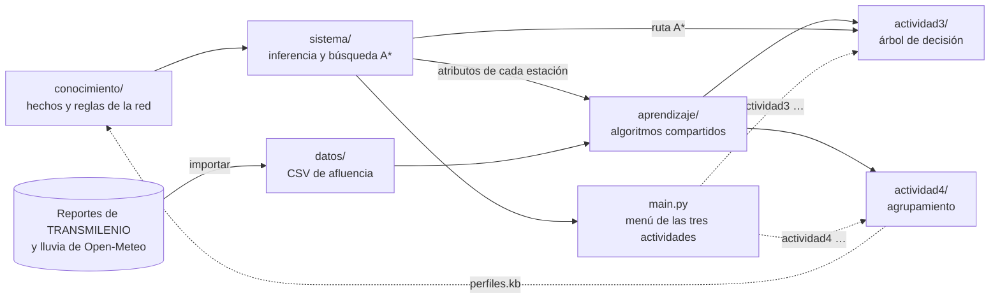
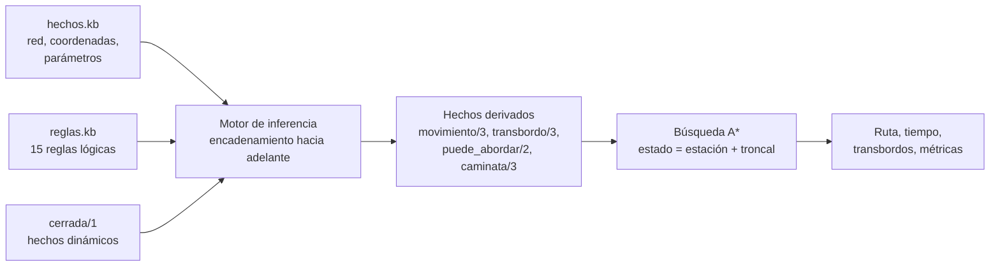

# Sistema inteligente de rutas en TransMilenio

Proyecto de Inteligencia Artificial sobre el sistema de transporte masivo de Bogotá, escrito en Python. Los algoritmos (inferencia, búsqueda y aprendizaje) están programados sin librerías externas; la única dependencia es [rich](https://rich.readthedocs.io), que da colores y formato a la consola. Se desarrolla en tres actividades que comparten la misma base de conocimiento de la red:

- **Actividad 2: sistema basado en reglas y búsqueda.** Está en la raíz del repositorio: `main.py`, `conocimiento/` y `sistema/`.
  - Encuentra la **mejor ruta** entre dos estaciones.
  - El conocimiento sobre la red está escrito como **hechos y reglas lógicas** (sintaxis tipo Prolog/Datalog).
  - Un **motor de inferencia** con encadenamiento hacia adelante deriva qué movimientos y transbordos son posibles.
  - Un **algoritmo de búsqueda heurística (A\*)** usa ese conocimiento para hallar la ruta de menor tiempo.
- **Actividad 3: aprendizaje supervisado** ([`actividad3/`](actividad3/README.md)). Un árbol de decisión aprende de los datos reales de TRANSMILENIO a predecir la demanda de cada estación por hora, y explica cada predicción con una regla.
- **Actividad 4: aprendizaje no supervisado** ([`actividad4/`](actividad4/README.md)). k-medias y agrupamiento jerárquico descubren, sin etiquetas, qué tipos de estación hay según su patrón de uso.

Inteligencia Artificial · Ingeniería de Software · Corporación Universitaria Iberoamericana.

- **Integrante:** Mateo Henao Correa (trabajo individual)
- **Repositorio:** https://github.com/Mateozzzz/Busqueda-y-sistemas-basados-en-reglas

## Inicio rápido

Requisitos: **Python 3.8 o superior** y la librería **rich**, que se instala con `requirements.txt`.

```bash
git clone https://github.com/Mateozzzz/Busqueda-y-sistemas-basados-en-reglas.git
cd Busqueda-y-sistemas-basados-en-reglas
pip install -r requirements.txt                       # rich: colores y formato de la consola
python main.py                                        # menú interactivo con las tres actividades
python main.py ruta "Portal El Dorado" "Museo del Oro"
```

En Windows puede usarse `py` en lugar de `python` (y `py -m pip install -r requirements.txt`). Si falta rich, el programa lo avisa con el comando para instalarla. Los nombres de estación se aceptan sin tildes ni mayúsculas (`heroes`, `av jimenez`).

Sin argumentos, `main.py` abre un menú con las tres actividades. Cada actividad tiene su submenú:
- las opciones agrupadas por sección, cada una con una descripción corta en la misma línea;
- arriba, el estado de la sesión: estaciones cerradas y fuente de datos;
- al elegir una opción, una explicación de lo que hace;
- al terminar cada acción, el **comando equivalente**, para repetirla sin el menú.

En la terminal, el encabezado es una franja roja, los números de opción van en cian, las secciones en amarillo y las descripciones en gris. Las estaciones cerradas se marcan en rojo y cada troncal tiene su color en las rutas. Sin colores, el menú se ve así:

```text
              SISTEMA INTELIGENTE DE RUTAS EN TRANSMILENIO
             Inteligencia Artificial · Actividades 2, 3 y 4

  ¿Qué desea hacer?

   2  Rutas óptimas              Actividad 2
      Base de conocimiento, motor de inferencia y búsqueda A*.

   3  Demanda en las estaciones  Actividad 3
      Árbol de decisión entrenado con datos reales de TRANSMILENIO.

   4  Tipos de estación          Actividad 4
      k-medias y Ward descubren tipos de estación según su uso.

   0  Salir

  Elija una opción › 2

╭──────────────────── ACTIVIDAD 2 · Rutas óptimas ─────────────────────╮
│    Base de conocimiento (conocimiento/) + búsqueda A* (sistema/)     │
╰──────────────────────────────────────────────────────────────────────╯
  Estaciones cerradas: ninguna

  BÚSQUEDA DE RUTAS
   1  Buscar la mejor ruta               Pasos, tiempo y transbordos con A*
   2  Comparar algoritmos de búsqueda    Amplitud, costo uniforme, voraz y A*
  BASE DE CONOCIMIENTO
   3  Consultar la base de conocimiento  Preguntas lógicas, ej. cabecera(E, T)
   4  Explicar una conclusión            Reglas y hechos que la demuestran
  RED DE ESTACIONES
   5  Cerrar o reabrir una estación      Las rutas se recalculan sin ella
   6  Ver estaciones y troncales         Todas, o una troncal en orden
  REGLAS Y PRUEBAS
   7  Ver las reglas del sistema         Las 15 reglas y las estadísticas
   8  Ejecutar los escenarios de prueba  10 casos; genera resultados_pruebas.md

   0  Volver al menú principal
```

Desde la línea de comandos, la misma ruta da:

```text
╭─ Ruta: Portal El Dorado → Museo del Oro ────────────────────────────────────╮
│  A* (A estrella) · criterio: tiempo                                         │
│                                                                             │
│  1. Aborde la troncal K (Calle 26) en Portal El Dorado.                     │
│     Viaje 13 parada(s) hasta Universidades (~31.1 min).                     │
│  2. Camine de Universidades a Las Aguas por la conexión peatonal (~4 min).  │
│  3. Aborde la troncal J (Eje Ambiental) en Las Aguas (espera ~5 min).       │
│     Viaje 1 parada(s) hasta Museo del Oro (~1.7 min).                       │
│                                                                             │
│  Resumen: ~41.8 min · 1 transbordo(s) · 14 parada(s)                        │
│  Búsqueda: 17 nodos expandidos, 32 generados, frontera máx. 2, 0.27 ms      │
╰─────────────────────────────────────────────────────────────────────────────╯
```

Con la salida redirigida a un archivo (`python main.py ruta ... > ruta.txt`), el texto se guarda sin códigos de color.

## Qué hay en cada carpeta

El repositorio separa cuatro cosas:
- el **conocimiento**: qué es la red;
- el **razonamiento**: cómo se busca una ruta;
- el **aprendizaje**: algoritmos que aprenden de datos;
- cada **actividad**: comandos, documentación y resultados.



| Carpeta | Actividad | Qué se hace ahí | Archivos principales |
|---|---|---|---|
| [`conocimiento/`](conocimiento/) | 2 (la usan también la 3 y la 4) | La **base de conocimiento**. Hechos lógicos de la red: 7 troncales, 85 tramos entre estaciones consecutivas, coordenadas de las 85 estaciones, 4 portales, una conexión peatonal y 3 parámetros. Además, 15 reglas sobre cómo moverse. No tiene código: se edita a mano. | `hechos.kb`, `reglas.kb` |
| [`sistema/`](sistema/) | 2 (la consola la usan también la 3 y la 4) | El **razonamiento**: analizador y motor de inferencia; capa de dominio (costos, heurística, nombres de estación); problema de búsqueda con 4 algoritmos; formato de la salida y consola con colores (rich). | `logica.py`, `red.py`, `busqueda.py`, `presentacion.py`, `consola.py` |
| `main.py` | 2, 3 y 4 | **Punto de entrada** del proyecto: menú interactivo con las tres actividades, comandos de la Actividad 2 y reenvío de los de las Actividades 3 y 4 (`python main.py actividad3 …`). | — |
| [`aprendizaje/`](aprendizaje/) | 3 y 4 | **Biblioteca compartida** de aprendizaje automático: conversión de los datos reales, muestra sintética, árbol de decisión, evaluación, agrupamiento y gráficos. No se ejecuta sola: la usan los comandos de las actividades. | `datos_reales.py`, `datos.py`, `arbol.py`, `evaluacion.py`, `agrupamiento.py`, `graficos.py`, `salida.py` |
| [`datos/`](datos/) | 3 y 4 | **Conjuntos de datos** en CSV que comparten las dos actividades. `crudos/` guarda los reportes descargados de TRANSMILENIO y no se sube a git. | `afluencia_transmilenio_real.csv` (42.560 filas), `afluencia_transmilenio_muestra.csv` (45.220), `estaciones.csv` (85) |
| [`actividad3/`](actividad3/README.md) | 3 | **Aprendizaje supervisado:** los comandos `python -m actividad3 …`, su README y `resultados/`, con el árbol entrenado, sus reglas y su reporte. | `supervisado.py`, `README.md`, `resultados/` |
| [`actividad4/`](actividad4/README.md) | 4 | **Aprendizaje no supervisado:** los comandos `python -m actividad4 …`, su README y `resultados/`, con los grupos, los mapas y los hechos `perfil_estacion/2`. | `no_supervisado.py`, `README.md`, `resultados/` |
| [`tests/`](tests/) | 2, 3 y 4 | **179 pruebas automáticas** (ver [Pruebas](#pruebas)), entre ellas pruebas avanzadas que comparan los algoritmos con implementaciones de referencia. | `test_*.py`, `oraculos.py` |

```text
Busqueda-y-sistemas-basados-en-reglas/
├── README.md                # este documento: proyecto completo y Actividad 2
├── main.py                  # punto de entrada: menú de las tres actividades y comandos
├── requirements.txt         # dependencia: rich (colores y formato de la consola)
├── conocimiento/            # base de conocimiento (Actividad 2)
│   ├── hechos.kb            # hechos: la red de TransMilenio
│   └── reglas.kb            # reglas: cómo moverse en la red
├── sistema/                 # razonamiento (Actividad 2)
│   ├── logica.py            # analizador + motor de inferencia + explicaciones
│   ├── red.py               # carga la base, costos, heurística, nombres
│   ├── busqueda.py          # problema de búsqueda y algoritmos
│   ├── presentacion.py      # formato de salida: texto para los reportes, paneles y tablas para la consola
│   └── consola.py           # consola con colores (rich): tema, tablas y mensajes de las tres actividades
├── aprendizaje/             # biblioteca de las Actividades 3 y 4
│   ├── datos_reales.py      # descarga y conversión de los reportes de TRANSMILENIO
│   ├── datos.py             # muestra sintética, festivos, catálogo de estaciones
│   ├── arbol.py             # árbol de decisión ID3/C4.5, ZeroR, OneR
│   ├── evaluacion.py        # particiones, validación cruzada, métricas
│   ├── agrupamiento.py      # k-medias++, jerárquico (Lance-Williams), silueta, ARI
│   ├── graficos.py          # gráficos SVG
│   └── salida.py            # tablas Markdown, porcentajes y escritura de archivos
├── datos/                   # datos de las Actividades 3 y 4
│   ├── afluencia_transmilenio_real.csv     # datos reales, 2 al 29 de marzo de 2026
│   ├── afluencia_transmilenio_muestra.csv  # muestra sintética, mismas columnas
│   ├── estaciones.csv                      # catálogo de estaciones desde la base de conocimiento
│   └── crudos/                             # descargas originales (ignorado por git)
├── actividad3/              # aprendizaje supervisado
│   ├── README.md            # fuentes, datos, modelo, resultados e interpretación
│   ├── supervisado.py       # comandos: importar, generar, explorar, entrenar, reglas, predecir, ruta
│   ├── __main__.py          # permite ejecutar "python -m actividad3"
│   └── resultados/          # modelo, reglas, árbol, gráficos y reporte (muestra/: con la muestra)
├── actividad4/              # aprendizaje no supervisado
│   ├── README.md            # fuentes, atributos, algoritmos, resultados e interpretación
│   ├── no_supervisado.py    # comandos: importar, generar, explorar, codo, agrupar
│   ├── __main__.py          # permite ejecutar "python -m actividad4"
│   └── resultados/          # k = 2 (k5/: k = 5; muestra/: con la muestra)
└── tests/                   # 179 pruebas (unittest) y oráculos de referencia
```

## Comandos

`main.py` es el punto de entrada de todo el proyecto: sin argumentos abre el menú; con un comando, lo ejecuta directamente.
- `python main.py -h` muestra los comandos organizados por actividad.
- `python main.py COMANDO -h` explica cada opción.

| Comando | Qué hace |
|---|---|
| `python main.py` | Menú interactivo con las tres actividades: un submenú por actividad con las opciones agrupadas por sección, una explicación por opción y el comando equivalente de cada acción. |
| `python main.py ruta ORIGEN DESTINO` | Mejor ruta con A\*. Opciones: `-a {a_estrella,costo_uniforme,voraz,amplitud}`, `-c {tiempo,transbordos}`, `-d` (detalle de estaciones), `--cerrar EST [EST ...]`. |
| `python main.py comparar ORIGEN DESTINO` | Ejecuta las 4 estrategias de búsqueda y compara tiempo, transbordos y nodos expandidos. |
| `python main.py consultar "CONSULTA"` | Consulta lógica sobre la base, p. ej. `"transbordo(E, T1, T2)"` o `"cabecera(E, T)"`. Con `--con actividad4/resultados/perfiles.kb` también consulta los perfiles de estación aprendidos en la Actividad 4. |
| `python main.py explicar PREDICADO ARG...` | Árbol de prueba de un hecho: qué reglas y premisas lo demuestran. Ej.: `explicar transbordo Ricaurte E F`. |
| `python main.py estaciones [--troncal K]` | Lista estaciones con sus troncales, o una troncal en orden. |
| `python main.py reglas` | Muestra las reglas y las estadísticas del encadenamiento hacia adelante. |
| `python main.py escenarios` | Corre los escenarios de prueba y genera `resultados_pruebas.md`. |
| `python main.py actividad3 COMANDO` | Comandos de la [Actividad 3](actividad3/README.md#4-comandos): `importar`, `generar`, `explorar`, `entrenar`, `reglas`, `predecir`, `ruta`. Equivale a `python -m actividad3 COMANDO`. |
| `python main.py actividad4 COMANDO` | Comandos de la [Actividad 4](actividad4/README.md#4-comandos): `importar`, `generar`, `explorar`, `codo`, `agrupar`. Equivale a `python -m actividad4 COMANDO`. |

Para consultas con constantes use comillas simples dentro de la consulta: `python main.py consultar "puede_abordar('Ricaurte', T)"`.

## Actividades 3 y 4: aprendizaje automático con datos reales

El proyecto continúa con dos modelos entrenados con las **entradas y salidas reales de TRANSMILENIO** por estación cada 15 minutos (marzo de 2026). Los datos vienen de su repositorio de datos abiertos y están enlazados con las estaciones de esta base de conocimiento.

| Actividad | Modelo | Comandos principales |
|---|---|---|
| [Actividad 3](actividad3/README.md): aprendizaje supervisado | Árbol de decisión ID3/C4.5 que predice el nivel de demanda (bajo, medio o alto) de una estación en una hora y lo explica con reglas. Se combina con la ruta A\*. | `python -m actividad3 entrenar`, `python -m actividad3 ruta "Portal El Dorado" "Museo del Oro" --hora 17` |
| [Actividad 4](actividad4/README.md): aprendizaje no supervisado | k-medias y agrupamiento jerárquico (Ward) que descubren tipos de estación por su patrón de uso. Los grupos vuelven a la base de conocimiento como hechos `perfil_estacion/2`. | `python -m actividad4 codo`, `python -m actividad4 agrupar` |

`python -m actividad3 importar` descarga y convierte los reportes oficiales. Una muestra sintética con las mismas columnas (`--datos muestra`) permite trabajar sin conexión y validar los métodos contra una verdad conocida.

Cada carpeta de actividad tiene tres partes:
- su **README**, con fuentes, método, comandos, resultados e interpretación;
- el **módulo de comandos** (`supervisado.py` o `no_supervisado.py`), que se ejecuta con `python -m actividad3` o `python -m actividad4`;
- la carpeta **`resultados/`**, que los comandos vuelven a generar cada vez.

Los algoritmos no están dentro de las actividades: viven en `aprendizaje/` y los datos en `datos/`, compartidos por las dos.

## Cómo funciona la Actividad 2 (`conocimiento/` y `sistema/`)



### 1. Representación del conocimiento (lógica): carpeta `conocimiento/`

`conocimiento/hechos.kb` describe la red:
- 7 troncales;
- 85 tramos entre estaciones consecutivas (`siguiente/3`);
- las coordenadas aproximadas de las 85 estaciones;
- 4 portales;
- la conexión peatonal Universidades – Las Aguas;
- 3 parámetros: velocidad comercial de 25 km/h, 0,5 min por parada y 5 min por transbordo.

`conocimiento/reglas.kb` contiene las 15 reglas sobre cómo moverse:

```prolog
tramo(A, B, T)        :- siguiente(A, B, T).
pertenece(E, T)       :- siguiente(E, _, T).
habilitada(E)         :- estacion(E), no cerrada(E).
movimiento(A, B, T)   :- tramo(A, B, T), habilitada(A), habilitada(B).
transbordo(E, T1, T2) :- pertenece(E, T1), pertenece(E, T2), distinto(T1, T2), habilitada(E).
```

Las variables van en mayúscula, `no` es negación por fallo y `distinto/2` es un predicado integrado. Ninguna estación de transbordo está escrita a mano: el sistema **infiere** que Ricaurte, Av. Jiménez, Héroes, Calle 100 y Escuela Militar son puntos de transbordo.

### 2. Motor de inferencia (sistema basado en reglas): `sistema/logica.py`

`sistema/logica.py` implementa, sin librerías externas, un analizador sintáctico para esa notación y un motor con **encadenamiento hacia adelante**: aplica las reglas hasta un punto fijo. Como hay negación, el motor **estratifica** el programa (evalúa `cerrada` antes que `habilitada`) y rechaza reglas inseguras o no estratificables. Cada hecho derivado guarda su justificación, lo que permite **explicar** las conclusiones:

```text
$ python main.py explicar transbordo Ricaurte E F
transbordo("Ricaurte", "E", "F")   [regla R9]
├── pertenece("Ricaurte", "E")   [regla R4]
│   └── siguiente("Paloquemao", "Ricaurte", "E")   [hecho]
├── pertenece("Ricaurte", "F")   [regla R3]
...
```

### 3. Búsqueda heurística: `sistema/red.py` y `sistema/busqueda.py`

`sistema/red.py` conecta la base de conocimiento con el buscador:
- carga hechos y reglas;
- agrega las estaciones cerradas como hechos dinámicos antes de inferir;
- calcula el costo de cada tramo y la heurística a partir de las coordenadas;
- reconoce los nombres de estación sin tildes.

`sistema/busqueda.py` formula el problema como búsqueda en un espacio de estados:

- **Estado:** (estación, troncal en la que viaja). Así el costo de un transbordo queda bien representado.
- **Acciones:** abordar, viajar a la estación vecina, hacer transbordo y caminar. Las acciones válidas se obtienen **consultando la base de conocimiento** (`puede_abordar`, `movimiento`, `transbordo`, `caminata`), no están programadas en Python.
- **Costo:** minutos = distancia del tramo / velocidad comercial + tiempo de parada; 5 min por transbordo. Con `-c transbordos` cada transbordo se penaliza fuertemente para minimizar su número.
- **Heurística:** h(n) = distancia en línea recta al destino / velocidad comercial. Es **admisible** (ningún recorrido es más corto que la línea recta) y **consistente** (desigualdad triangular), por lo que A\* garantiza la ruta óptima. Las pruebas automáticas lo verifican para los 7.225 pares de estaciones y para cada arista del espacio de estados.

Se incluyen cuatro estrategias para comparar: primero en amplitud y costo uniforme (no informadas), voraz y A\* (informadas).

```text
$ python main.py comparar "Escuela Militar" "U. Nacional"
Comparación de estrategias: Escuela Militar → U. Nacional ──────────────────────────────
Criterio: tiempo · en verde, el mejor tiempo y la que expandió menos nodos
╭────────────────────────┬─────────┬─────────┬─────────┬────────────┬───────────┬──────╮
│ Algoritmo              │ Minutos │ Transb. │ Paradas │ Expandidos │ Generados │   ms │
├────────────────────────┼─────────┼─────────┼─────────┼────────────┼───────────┼──────┤
│ A* (A estrella)        │    13.2 │       0 │       6 │         10 │        23 │ 0.34 │
│ Costo uniforme         │    13.2 │       0 │       6 │         21 │        48 │ 0.46 │
│ Primero el mejor voraz │    60.9 │       3 │      22 │         27 │        63 │ 0.67 │
│ Primero en amplitud    │    13.2 │       0 │       6 │         24 │        55 │ 0.47 │
╰────────────────────────┴─────────┴─────────┴─────────┴────────────┴───────────┴──────╯
Ruta encontrada por A*: Escuela Militar → NQS Calle 75 → Av. Chile → 7 de Agosto →
Movistar Arena → Campín → U. Nacional
```

A\* halla el óptimo expandiendo la mitad de nodos que costo uniforme; la búsqueda voraz se deja engañar porque la troncal Caracas pasa "cerca" del destino, pero no conecta con él.

`sistema/presentacion.py` da formato a la ruta y a las tablas de comparación: texto plano para los reportes Markdown, y paneles y tablas con colores para la consola. Los colores y las utilidades de la consola (tablas, mensajes, encabezados) están en `sistema/consola.py`, que usan las tres actividades.

## Pruebas

La carpeta `tests/` reúne 179 pruebas automáticas (unittest) de las tres actividades:

```bash
python -m unittest -v                           # las 179 pruebas (unos 20 s)
python -m unittest discover -p "*avanzad*.py"   # solo las pruebas avanzadas
python -m unittest tests.test_reproducibilidad  # solo las que comparan con lo publicado
python main.py escenarios                       # 10 escenarios de uso de la Actividad 2 -> resultados_pruebas.md
```

| Archivo | Actividad | Pruebas | Qué comprueba |
|---|---|---|---|
| `test_logica.py` | 2 | 13 | Analizador: comentarios, comillas, errores con número de línea. Inferencia: encadenamiento hacia adelante recursivo, negación por fallo, hechos dinámicos y `distinto/2`. Rechazo de reglas inseguras y no estratificables. Explicaciones. |
| `test_busqueda.py` | 2 | 16 | Coordenadas completas, transbordos inferidos, tramos bidireccionales y nombres sin tildes. A\* es óptimo en 156 pares (comparado con un Dijkstra de referencia) y nunca expande más nodos que costo uniforme; la heurística es admisible en los 7.225 pares de estaciones y consistente en cada arista; la búsqueda voraz puede ser subóptima. Conexión peatonal, estaciones cerradas, ausencia de ruta y criterio de transbordos (primero los menos transbordos, luego el menor tiempo). |
| `test_datos_reales.py` | 3 y 4 | 7 | Conversor de los reportes reales, con XLSX mínimos y sin conexión: suma por hora, estaciones con dos códigos, fila de total general, festivos y lluvia. Tabla de códigos de estación. |
| `test_datos.py` | 3 y 4 | 11 | Muestra sintética reproducible, atributos tomados de la base de conocimiento, festivos de Colombia, lectura y escritura del CSV, unión con el catálogo. |
| `test_arbol.py` | 3 | 18 | Entropía e ID3 con el ejemplo clásico "jugar tenis", razón de ganancia (con un caso en que C4.5 e ID3 eligen raíces distintas), umbrales numéricos, reglas, ZeroR y OneR. Métricas, particiones estratificadas, validación cruzada con la regla de un error estándar y el árbol sobre la muestra. |
| `test_agrupamiento.py` | 4 | 15 | k-medias, jerárquico con los cuatro enlaces y sin inversiones en ninguno, silueta e índice de Rand ajustado. Perfiles por estación, nombres de los grupos y hechos `perfil_estacion/2`. |
| `test_main.py` | 2, 3 y 4 | 15 | El punto de entrada `main.py`: ayuda organizada por actividad, reenvío a las Actividades 3 y 4, `consultar --con` y explicaciones que muestran tal cual sus marcas entre corchetes (`[regla R9]`, `[hecho]`). Los 10 escenarios aprobados en su reporte, una troncal en orden, errores con código 1 y sugerencias, y la comparación de las 4 estrategias. Además, el menú con respuestas simuladas: secciones del submenú, ruta, predicción con una entrada inválida, estación cerrada compartida entre actividades, perfiles de la Actividad 4 (las carpetas `kN` en orden natural), opción inválida y fin de la entrada. |

### Pruebas avanzadas

Las pruebas anteriores revisan ejemplos escogidos a mano. Las avanzadas buscan los errores que esos ejemplos no muestran:

- **Oráculos:** cada algoritmo se compara con una implementación de referencia simple, lenta e independiente, en [`tests/oraculos.py`](tests/oraculos.py): Dijkstra completo y BFS para la búsqueda, cierre transitivo para la inferencia, búsqueda exhaustiva de la mejor división para el árbol, enlaces recalculados desde su definición para el agrupamiento jerárquico, y silueta y Rand ajustado contando pares.
- **Propiedades sobre datos aleatorios:** cientos de casos generados con semilla fija (siempre los mismos) en los que debe cumplirse una propiedad; por ejemplo, que las reglas de un árbol cubran cada ejemplo exactamente una vez.
- **Pruebas metamórficas:** un cambio conocido en la entrada tiene un efecto predecible; por ejemplo, cerrar una estación que no está en la ruta óptima no cambia su costo.
- **Dobles de prueba:** un espía comprueba que la validación cruzada nunca entrena con los ejemplos que valida, y las descargas se simulan para probar la importación sin conexión.
- **Reproducibilidad:** lo publicado (ejemplos del README, CSV de `datos/`, modelos y reportes de `resultados/`) se vuelve a generar igual con el código actual, y los resultados no dependen del orden interno de Python (`PYTHONHASHSEED`). Si una de estas pruebas falla después de un cambio intencional, hay que regenerar lo publicado (`generar`, `entrenar` o `agrupar`) o actualizar el README.

| Archivo | Actividad | Pruebas | Qué comprueba |
|---|---|---|---|
| `test_logica_avanzada.py` | 2 | 16 | El encadenamiento hacia adelante coincide con un BFS en 40 grafos aleatorios, también con negación sobre un predicado recursivo. Tres estratos y ciclos negativos que pasan por varias reglas. Cierres y reaperturas en secuencia (`retirar_hecho`). Todo hecho escrito con `formatear_hecho` se vuelve a leer igual, aun con comillas y barras invertidas. Variables anónimas, aridades, `igual/2`, mensajes de error y explicaciones que no dependen del orden de los hechos. |
| `test_busqueda_avanzada.py` | 2 | 11 | Las cifras del README (85 tramos, 15 reglas, 5 estaciones de transbordo, una cabecera por troncal) y la red conexa. Cada paso de cada ruta, con los 4 algoritmos y los 2 criterios, está justificado por un hecho de la base; el costo es la suma de los pasos; amplitud usa el mínimo de acciones. Cerrar una estación fuera de la ruta no cambia el costo; cerrar una de la ruta nunca la abarata. |
| `test_aprendizaje_avanzado.py` | 3 y 4 | 29 | El árbol elige la misma división que una búsqueda exhaustiva y la simplificación final nunca cambia una predicción; reglas, predicción truncada, JSON e importancia en árboles aleatorios. OneR con atributos numéricos. Métricas, particiones y validación cruzada sin fuga de datos. Los cuatro enlaces contra su definición, cortes anidados, silueta, Rand ajustado y propiedades de k-medias. Atributos de los perfiles calculados a mano. |
| `test_datos_avanzados.py` | 3 y 4 | 19 | Pascua de 1583 a 2400 y festivos de Colombia de 1984 a 2100 (en 2025 dos festivos caen el mismo día). La muestra refleja los factores de su modelo (fin de semana y lluvia). Lector de XLSX: columnas hasta XFD, horas guardadas con 15 cifras, varias hojas y celdas sin referencia. Descarga con caché, descarga interrumpida e importación completa sin conexión. |
| `test_reproducibilidad.py` | 2, 3 y 4 | 9 | Los ejemplos del README (ruta, comparación de estrategias y explicación) salen tal cual del programa. La muestra y el catálogo de `datos/` se regeneran idénticos, y los datos reales cumplen su contrato (malla completa, sin duplicados, calendario coherente). El árbol guardado reproduce su reporte, sus reglas y su árbol; `agrupar` regenera los 9 archivos de cada carpeta de resultados. Nada depende de `PYTHONHASHSEED`. |

## Cómo extender la base de conocimiento

Para agregar una troncal (por ejemplo Suba, código C) basta editar `conocimiento/hechos.kb`:

```prolog
troncal("C", "Suba").
siguiente("Portal Suba", "La Campiña", "C").
% ... resto de tramos
coordenadas("Portal Suba", 4.7460, -74.0940).
```

No hay que tocar el código: las reglas infieren automáticamente los nuevos transbordos. Si falta la coordenada de alguna estación, el sistema lo informa al iniciar.

Las Actividades 3 y 4 toman las estaciones de esta misma base:
- La muestra sintética (`generar`) incluye las estaciones nuevas de inmediato.
- Para los datos reales, cada estación nueva necesita su código del sistema de recaudo en `CODIGOS_ESTACION` (`aprendizaje/datos_reales.py`) y volver a ejecutar `python -m actividad3 importar`.
- Mientras tanto, el árbol de la Actividad 3 igual predice la demanda de esas estaciones a partir de sus atributos.

## Limitaciones de la Actividad 2

- Es una red **simplificada** (7 troncales, 85 estaciones). El orden de estaciones se basó en información pública de TransMilenio, pero las coordenadas son **aproximadas** y deben validarse contra el mapa oficial o el portal de datos abiertos de TransMilenio antes de cualquier uso real.
- Modela troncales, no servicios (B12, D21…): no distingue rutas expresas de corrientes ni frecuencias, y un cambio de troncal siempre cuenta como transbordo.
- Los tiempos son estimaciones por distancia; no consideran congestión ni hora pico.
- Una estación cerrada se trata como fuera de servicio y sin paso.

Las limitaciones de los modelos de aprendizaje están en la sección 7 de cada actividad: [Actividad 3](actividad3/README.md#7-limitaciones) y [Actividad 4](actividad4/README.md#7-limitaciones).

## Referencias

- Benítez, R. (2014). *Inteligencia artificial avanzada*. Barcelona: Editorial UOC. Caps. 2, 3 y 9.
- Russell, S. y Norvig, P. (2021). *Artificial Intelligence: A Modern Approach* (4.ª ed.). Pearson. Caps. 3, 7 y 9.
- TransMilenio S.A. Información de troncales y estaciones: https://www.transmilenio.gov.co
