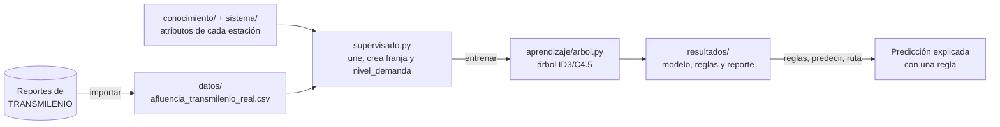
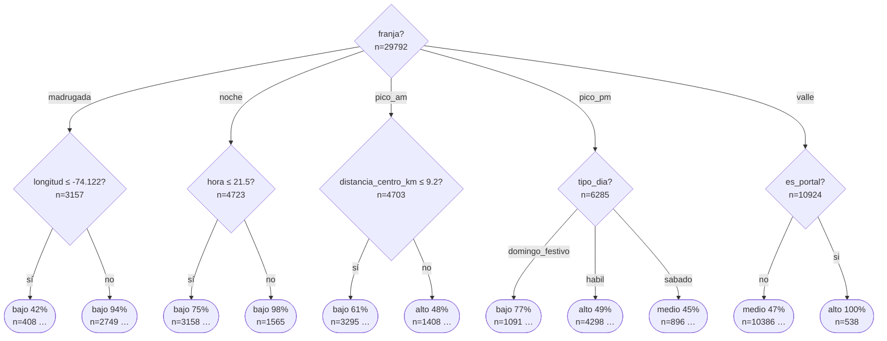

# Actividad 3 · Aprendizaje supervisado: demanda en las estaciones de TransMilenio

Inteligencia Artificial · Ingeniería de Software · Corporación Universitaria Iberoamericana.
Continúa el proyecto de la [Actividad 2](../README.md) (ruta óptima en TransMilenio con base de conocimiento y A\*).

## Objetivo

Construir un modelo de **aprendizaje supervisado** que prediga el **nivel de demanda** de entradas de una estación en una hora: **bajo**, **medio** o **alto**. Usa como entrada:
- el momento: hora, tipo de día y lluvia;
- las características de la estación: portal, integración, troncales y ubicación.

El modelo se entrena con **datos reales de TRANSMILENIO**: entradas y salidas por estación, del 2 al 29 de marzo de 2026.

El modelo es un **árbol de decisión** (Palma Méndez, 2008, cap. 17) implementado desde cero en Python, sin librerías externas, igual que los demás algoritmos del proyecto. Cada hoja del árbol se convierte en una **regla SI … ENTONCES …** con su soporte y confianza, de modo que el sistema puede explicar cada predicción.

Para qué sirve:
- **Operación:** anticipar en qué estaciones y horas reforzar flota y personal.
- **Usuario:** conectado con el buscador de rutas de la Actividad 2, avisa si en los puntos de abordaje de la ruta habrá filas largas.

## Qué hay en esta carpeta

`actividad3/` reúne los **comandos**, la **documentación** y los **resultados** del aprendizaje supervisado. Los algoritmos y los datos no están aquí: viven en carpetas que comparte con la Actividad 4, para no duplicar código.



| Archivo o carpeta | Qué es | Cómo se genera o se usa |
|---|---|---|
| `README.md` | Este documento: fuentes, datos, modelo, comandos, resultados, interpretación y limitaciones. | Se escribe a mano. |
| [`supervisado.py`](supervisado.py) | Los comandos de la actividad. Une cada fila de datos con los atributos de su estación, deriva `franja` y la etiqueta `nivel_demanda`, entrena y evalúa el árbol, escribe el reporte y responde predicciones. | `python -m actividad3 <comando>`: `importar`, `generar`, `explorar`, `entrenar`, `reglas`, `predecir`, `ruta` (sección 4). |
| `__main__.py`, `__init__.py` | Hacen de la carpeta un paquete ejecutable. | Permiten escribir `python -m actividad3`. |
| [`resultados/modelo_arbol.json`](resultados/modelo_arbol.json) | El árbol entrenado con los datos reales. Lo leen `reglas`, `predecir` y `ruta`. | `python -m actividad3 entrenar` |
| [`resultados/reglas.txt`](resultados/reglas.txt), [`resultados/arbol.txt`](resultados/arbol.txt) | Las 336 reglas y el árbol completo, en texto. | `entrenar` |
| `resultados/curva_profundidad.svg`, `resultados/importancia_atributos.svg` | Exactitud según la profundidad (validación cruzada) e importancia de cada atributo. | `entrenar` |
| [`resultados/reporte.md`](resultados/reporte.md) | Reporte completo: datos, validación cruzada, métricas, matriz de confusión, árbol, reglas y ejemplos. | `entrenar` |
| [`resultados/muestra/`](resultados/muestra/reporte.md) | Los mismos seis archivos, entrenados con la muestra sintética. | `python -m actividad3 entrenar --datos muestra` |

Lo que usa de otras carpetas:

| Carpeta | Qué toma de ahí |
|---|---|
| [`datos/`](../datos/) | Los ejemplos: una fila por estación, día y hora. `afluencia_transmilenio_real.csv` lo crea `importar`; `afluencia_transmilenio_muestra.csv`, `generar`. |
| [`aprendizaje/`](../aprendizaje/) | `datos_reales.py`: descarga y conversión de los reportes. `datos.py`: muestra, festivos y atributos de estación. `arbol.py`: árbol, reglas, ZeroR y OneR. `evaluacion.py`: particiones, validación cruzada y métricas. `graficos.py` y `salida.py`: gráficos SVG y tablas. |
| [`conocimiento/`](../conocimiento/) y [`sistema/`](../sistema/) | Los atributos de cada estación (troncales, portal, integración, coordenadas) se infieren de la base de conocimiento de la Actividad 2. El comando `ruta` usa su búsqueda A\*. |
| [`tests/`](../tests/) | `test_datos_reales.py`, `test_datos.py` y `test_arbol.py` (36 pruebas). Pruebas avanzadas: `test_aprendizaje_avanzado.py` compara el árbol con una búsqueda exhaustiva y revisa sus propiedades en datos aleatorios; `test_datos_avanzados.py`, el calendario, el lector de XLSX y la importación sin conexión; `test_reproducibilidad.py` comprueba que el modelo guardado reproduce `resultados/`. |

## 1. Fuentes de datos identificadas

| Fuente | Publica | Qué contiene | Uso en el proyecto |
|---|---|---|---|
| [Validaciones mensuales troncales](https://storage.googleapis.com/validaciones_tmsa/validaciones_mensuales.html) | TRANSMILENIO S.A., repositorio de datos abiertos [`validaciones_tmsa`](https://storage.googleapis.com/validaciones_tmsa/index.html) | Un XLSX por mes, de 2012 a 2026, con las validaciones de ingreso por estación, acceso e intervalo de 15 minutos. Trae una columna por día del mes; el de marzo de 2026 pesa 13,7 MB. | **Variable objetivo:** entradas por estación y hora. |
| [Salidas mensuales](https://storage.googleapis.com/validaciones_tmsa/salidas_mensuales.html) | TRANSMILENIO S.A., mismo repositorio | Lo mismo para los torniquetes de salida (XLSX mensual, de 2012 a 2026). [Datos Abiertos Bogotá](https://datosabiertos.bogota.gov.co/dataset/consolidado-de-salidas-sistema-troncal-por-franja-horaria) lo publica además como CSV de 2020 a noviembre de 2024, con licencia CC BY 4.0. | Columna `salidas`, que se usa en la [Actividad 4](../actividad4/README.md). |
| [Validaciones diarias](https://storage.googleapis.com/validaciones_tmsa/validaciones_diarias.html) | TRANSMILENIO S.A., mismo repositorio | Un registro por transacción con 21 campos: `Fecha_Transaccion`, `Estacion_Parada`, `Acceso_Estacion`, `Numero_Tarjeta`, saldos, tarifa, etc. | No se usa: los reportes mensuales ya vienen agregados por estación y 15 minutos, y así no hay que manejar números de tarjeta. |
| [Estaciones Troncales de TRANSMILENIO](https://datosabiertos.bogota.gov.co/dataset/estaciones-troncales-de-transmilenio1) | TRANSMILENIO S.A. en Datos Abiertos Bogotá (CC BY 4.0) | Ubicación de las paradas troncales (CSV, GeoJSON, Shapefile, KML). | Catálogo de estaciones. En el proyecto se toma de la base de conocimiento de la Actividad 2 (`conocimiento/hechos.kb`). |
| [Trazados Troncales](https://datosabiertos.bogota.gov.co/dataset/trazados-troncales-de-transmilenio) y [GTFS](https://datosabiertos-transmilenio.hub.arcgis.com/) | TRANSMILENIO S.A. (CC BY 4.0) | Trazado de las troncales; servicios, paradas y horarios. | Validar el orden de las estaciones. |
| [Open-Meteo, Historical Weather API](https://open-meteo.com/en/docs/historical-weather-api) | Open-Meteo (datos CC BY 4.0; gratuita para uso no comercial) | Precipitación horaria histórica en cualquier coordenada, a partir de reanálisis ERA5 y ECMWF IFS. | Atributo `lluvia`. |
| [DHIME](http://dhime.ideam.gov.co/atencionciudadano/) | IDEAM | Precipitación medida en estaciones pluviométricas, con descarga manual. | Alternativa oficial para `lluvia`. |
| [Encuesta de Movilidad 2023](https://www.simur.gov.co/encuestas-de-movilidad) | Secretaría Distrital de Movilidad (SIMUR) | Encuesta origen-destino de hogares en Bogotá y 20 municipios vecinos. | Contexto: horas pico y viajes casa-trabajo. |

**Licencia:**
- El repositorio `validaciones_tmsa` no declara una licencia en sus páginas.
- El conjunto equivalente de salidas en Datos Abiertos Bogotá se publica con CC BY 4.0.
- Este proyecto cita la fuente y solo redistribuye el agregado por estación y hora.

## 2. Datos

### 2.1 Datos reales (base del modelo)

```bash
python -m actividad3 importar
```

```text
Datos reales: 42560 filas (80 estaciones × 19 horas × 28 días, 2026-03-02 a 2026-03-29)
  datos/afluencia_transmilenio_real.csv
Estaciones de la base de conocimiento sin datos en el sistema de recaudo (5): Calle 19, Calle 63, Calle 72, Patio Bonito, Tercer Milenio
Horas con lluvia (≥ 0.2 mm, Open-Meteo): 21.6 %
```

El comando, implementado en [`aprendizaje/datos_reales.py`](../aprendizaje/datos_reales.py), hace lo siguiente:
1. **Descarga** los reportes de marzo de 2026: entradas (13,7 MB) y salidas (6,1 MB).
   - Lo hace una sola vez, en `datos/crudos/`, carpeta que git ignora.
   - Con `--entradas` y `--salidas` se le pasa otro mes, como URL o como archivo local.
2. **Lee los XLSX con la librería estándar** (`zipfile` + `xml.etree`) y suma los accesos de cada estación y los cuatro intervalos de 15 minutos de cada hora.
   - Solo cuenta las filas de detalle: la hoja trae además una fila de total general que duplicaría las cifras.
3. **Enlaza cada estación** de la base de conocimiento con su código en el sistema de recaudo (tabla `CODIGOS_ESTACION`).
   - El código no cambia con los nombres comerciales: `(02000) Portal Norte - Unicervantes` es Portal Norte.
4. **Agrega la lluvia horaria** de Open-Meteo en el centro de Bogotá (Av. Jiménez). Se considera que llovió si cayeron al menos 0,2 mm en la hora.
5. **Escribe `datos/afluencia_transmilenio_real.csv`** con las mismas columnas que la muestra sintética.

**Ventana:** del 2 al 29 de marzo de 2026, las mismas cuatro semanas de la muestra.
- Son 19 días hábiles, 4 sábados y 5 domingos o festivos; el lunes 23 es festivo (San José).
- Se dejan fuera el 30 y el 31, lunes y martes de Semana Santa, con cerca de 20 % menos validaciones.

**Enlace con la base de conocimiento: 80 de las 85 estaciones tienen datos.**
- **Sin registros en marzo de 2026:** Calle 19, Calle 63, Calle 72 y Tercer Milenio, todas de la troncal Caracas. La construcción del viaducto de la primera línea del metro obligó a cerrar o trasladar estaciones en esa troncal ([Publimetro, 2025](https://www.publimetro.co/bogota/2025/02/27/cuando-reabriran-las-estaciones-de-transmilenio-cerradas-en-la-avenida-caracas-esto-dice-la-gerente/)). Patio Bonito tampoco aparece en los reportes.
- **Datos de la estación temporal:** Calle 22, Calle 34, Av. 39, Marly y Calle 57.
- **Dos códigos sumados:**
  - Av. Jiménez: la permanente y la temporal.
  - Granja - Carrera 77: los códigos de La Granja y de Carrera 77.
  - Ricaurte: el de NQS - Ricaurte y el de Ricaurte en la Calle 13.
- **Nombre anterior:** Distrito Grafiti aparece como «Américas - Cr. 53», su nombre hasta 2019.

**Control de calidad del conversor:**
- La suma de las filas de detalle del reporte de entradas coincide con los totales diarios oficiales de la hoja de resumen en los 31 días de marzo. Por ejemplo, 1.874.847 validaciones el lunes 2.
- Tres celdas estación-día-hora recalculadas por un camino independiente coinciden con el CSV.

### 2.2 Muestra sintética (respaldo y verdad conocida)

```bash
python -m actividad3 generar          # --dias 28 --semilla 42 por defecto
```

[`datos/afluencia_transmilenio_muestra.csv`](../datos/afluencia_transmilenio_muestra.csv) tiene 45.220 filas: las 85 estaciones × 19 horas × los mismos 28 días. Las columnas son las mismas y se genera con semilla fija, siempre idéntica byte a byte.

Se conserva por tres razones:
- Permite trabajar **sin conexión** y alimenta las **pruebas automáticas**.
- Es una **verdad conocida**: cada estación tiene una vocación oculta con la que se generaron sus datos, así se comprueba que los métodos la recuperan.
- Sus supuestos, contrastados con los datos reales, muestran **qué tan bien** describen la ciudad (sección 6).

Cualquier comando usa la muestra con `--datos muestra`, y entonces guarda sus resultados en [`resultados/muestra/`](resultados/muestra/reporte.md).

<details>
<summary>Supuestos con los que se genera la muestra</summary>

Los valores son **plausibles pero no reales**:

- **Vocación oculta de cada estación:**
  - **Empleo** u **educativa / ocio**, según una lista explícita de atractores (Calle 72, Calle 100, CAN, U. Nacional, Campín, Corferias, etc.).
  - Si no está en la lista: **residencial** si es portal o está a más de 7,5 km del centro, y **mixta** en otro caso.
  - La vocación **no** se guarda en el CSV.
- **Perfiles horarios:**
  - Las residenciales generan entradas en la mañana y salidas en la tarde; las de empleo, al revés.
  - Las educativas tienen picos al mediodía y en la noche, y más uso en fin de semana.
  - Ninguna estación es "pura": su perfil se mezcla hasta en un 45 % con otro uso.
- **Volumen diario:**
  - Base de 6.500 a 10.000 entradas en un día hábil.
  - Portales × 3,5 e integración × 1,5, más un factor aleatorio propio de cada estación.
  - Sábados al 55 % de un día hábil y domingos o festivos al 32 %.
- **Lluvia:** cae en toda la ciudad a la vez, es más probable en la tarde y suma un 10 % de demanda.
- **Ruido:** log-normal en cada hora.

Ver [`aprendizaje/datos.py`](../aprendizaje/datos.py).
</details>

### 2.3 Diccionario de datos (igual para los dos conjuntos)

| Columna | Tipo | Descripción |
|---|---|---|
| `fecha` | fecha | Día de la observación. |
| `dia_semana` | texto | lunes … domingo. |
| `tipo_dia` | categórico | `habil`, `sabado` o `domingo_festivo`. Los festivos se calculan con la Ley 51 de 1983. |
| `hora` | entero 4-22 | Franja de una hora (7 = 7:00 a 7:59). |
| `estacion` | texto | Nombre de la estación (clave para unir con el catálogo). |
| `lluvia` | si / no | Si llovió en la ciudad en esa hora. En los datos reales, ≥ 0,2 mm según Open-Meteo. |
| `entradas` | entero | Validaciones de ingreso en la hora. |
| `salidas` | entero | Salidas por torniquete en la hora. |

Al cargar los datos se unen por `estacion` con [`datos/estaciones.csv`](../datos/estaciones.csv), el catálogo derivado de la base de conocimiento:

| Columna | Tipo | Descripción |
|---|---|---|
| `troncales` | texto | Troncales de la estación, ej. `A\|F\|J` (inferidas con las reglas R3/R4 de la Actividad 2). |
| `latitud`, `longitud` | número | Coordenadas aproximadas de la base de hechos. |
| `es_portal` | si / no | Hecho `portal/1` de la base de conocimiento. |
| `es_integracion` | si / no | Inferido con las reglas R12/R13 (`estacion_de_integracion/1`). |
| `num_troncales` | entero | Número de troncales que pasan por la estación. |
| `distancia_centro_km` | número | Distancia en línea recta a Av. Jiménez (fórmula de Haversine). |

Dos atributos se **derivan** al cargar los datos:
- `franja`: madrugada (4-5), pico_am (6-8), valle (9-15), pico_pm (16-19), noche (20-22). Es conocimiento del dominio que agrupa las horas como las horas pico de TransMilenio.
- `nivel_demanda` (la **etiqueta**), según las entradas por hora: bajo si son menos de 250; medio entre 250 y 799; alto si son 800 o más.

| Clase | Datos reales | Muestra sintética |
|---|---|---|
| bajo | 21.304 (50,1 %) | 18.354 (40,6 %) |
| medio | 13.824 (32,5 %) | 20.846 (46,1 %) |
| alto | 7.432 (17,5 %) | 6.020 (13,3 %) |

## 3. Modelo: árbol de decisión (cap. 17)

Implementación en [`aprendizaje/arbol.py`](../aprendizaje/arbol.py):

- **Inducción descendente** al estilo ID3 / C4.5 (Quinlan):
  - En cada nodo se elige el atributo que más reduce la entropía:
    `H(S) = -Σ p·log2(p)` y `Ganancia(S, A) = H(S) - Σ |Sᵥ|/|S| · H(Sᵥ)`.
  - Opcional: **razón de ganancia** de C4.5 (`--criterio razon`), que corrige el sesgo de la ganancia hacia atributos con muchos valores.
- **Atributos categóricos:** una rama por valor.
- **Atributos numéricos:** división binaria `A ≤ umbral`, con el umbral en el punto medio entre valores consecutivos.
- **Pre-poda:** profundidad máxima, mínimo de 20 ejemplos por hoja y ganancia mínima. Si todas las hojas de un subárbol predicen la misma clase, el subárbol se reemplaza por una hoja.
- **Elección de la profundidad por validación cruzada estratificada** de 5 pliegues, con la regla de *un error estándar*: entre las profundidades casi tan buenas como la mejor, se elige la menor.
  - Como cada nodo guarda su clase mayoritaria, un solo árbol por pliegue se evalúa "truncado" a cada profundidad.
- **Reglas:** cada camino de la raíz a una hoja es una regla `SI … ENTONCES clase [soporte, confianza]`. Las condiciones sobre un mismo atributo se unen en intervalos (`6.5 < hora ≤ 8.5`).
- **Líneas base:**
  - **ZeroR:** siempre la clase mayoritaria.
  - **OneR** (Holte, 1993): una regla por cada valor de *un solo* atributo.

Decisiones de diseño:
- **No se usa el nombre de la estación como atributo.**
  - El árbol aprende de características (portal, integración, distancia al centro, ubicación), así que puede predecir para estaciones sin datos, como las cuatro cerradas de la Caracas.
  - Además, un atributo con 80 valores es justo el caso en que la ganancia de información favorece divisiones inútiles.
- **`franja` mejora los árboles pequeños.**
  - Con profundidad 4, agregarla sube la exactitud en prueba de 63,2 % a 68,9 %.
  - Con profundidad 14 apenas cambia (88,3 % frente a 89,1 %), porque el árbol reconstruye las franjas a partir de `hora`.

## 4. Comandos

Requisitos: Python 3.8 o superior y la librería rich para la consola (`pip install -r requirements.txt`). Todos los comandos se ejecutan desde la raíz del repositorio.

También se pueden usar sin escribir comandos, desde el menú de `python main.py` (opción 3, «Demanda en las estaciones»). Otra forma equivalente es `python main.py actividad3 COMANDO`.

| Comando | Qué hace |
|---|---|
| `python -m actividad3 importar` | Descarga y convierte los datos reales (sección 2.1). El CSV resultante ya está en el repositorio. |
| `python -m actividad3 generar` | Genera la muestra sintética (sección 2.2). |
| `python -m actividad3 explorar` | Análisis exploratorio. |
| `python -m actividad3 entrenar` | Partición estratificada 70/30, validación cruzada de la profundidad entre 1 y 20, entrenamiento, comparación con ZeroR y OneR, métricas, árbol y reglas. |
| `python -m actividad3 reglas --clase alto --top 5` | Reglas del modelo guardado. |
| `python -m actividad3 predecir --estacion "Portal Norte" --hora 6 --dia habil` | Predicción explicada con la regla que se activa. |
| `python -m actividad3 ruta "Portal El Dorado" "Museo del Oro" --hora 17` | Ruta A\* de la Actividad 2 con la demanda prevista en cada abordaje. |

- **Dónde se guardan los resultados:** `entrenar` guarda en [`resultados/`](resultados/) el modelo (`modelo_arbol.json`), las reglas, el árbol completo, los gráficos y el [reporte](resultados/reporte.md). Tarda unos 11 s.
- **Opción `--datos muestra`:** todos los comandos usan la muestra sintética en lugar de los datos reales, y sus resultados van a [`resultados/muestra/`](resultados/muestra/reporte.md).
- **Otras opciones útiles:**
  - `--lluvia` y `--dia sabado|domingo_festivo`.
  - `--cerrar ESTACION` (en `ruta`).
  - `--criterio razon` y `--profundidad N` (en `entrenar`; la segunda fija un árbol pequeño e interpretable).

```bash
python -m actividad3 explorar
```

```text
Dataset de afluencia (datos reales de TRANSMILENIO) ────────────────────────────────────
Filas             42560
Estaciones        80
Días              28 (2026-03-02 a 2026-03-29)
Horas             4:00-22:59
Tipo de día       domingo_festivo 7600 · habil 28880 · sabado 6080
Horas con lluvia  21.6 %
Columnas          fecha, dia_semana, tipo_dia, hora, estacion, lluvia, entradas,
                  salidas, troncales, latitud, longitud, es_portal, es_integracion,
                  num_troncales, distancia_centro_km

Entradas por estación-hora
╭─────┬────┬─────────┬─────┬───────┬───────╮
│ Mín │ Q1 │ Mediana │  Q3 │   Máx │ Media │
├─────┼────┼─────────┼─────┼───────┼───────┤
│   0 │ 90 │     249 │ 571 │ 15424 │   540 │
╰─────┴────┴─────────┴─────┴───────┴───────╯

Entradas promedio por franja y tipo de día
╭───────────┬───────┬────────┬─────────────────╮
│ Franja    │ habil │ sabado │ domingo_festivo │
├───────────┼───────┼────────┼─────────────────┤
│ madrugada │   347 │    171 │              59 │
│ pico_am   │   965 │    465 │             157 │
│ valle     │   600 │    531 │             231 │
│ pico_pm   │  1104 │    412 │             214 │
│ noche     │   166 │    108 │              50 │
╰───────────┴───────┴────────┴─────────────────╯

Estaciones con más entradas en un día hábil promedio
╭──────────────────┬──────────────┬────────┬─────────────╮
│ Estación         │ Entradas/día │ Portal │ Integración │
├──────────────────┼──────────────┼────────┼─────────────┤
│ Portal Américas  │       73.616 │ si     │ no          │
│ Portal Norte     │       69.810 │ si     │ no          │
│ Portal 80        │       55.390 │ si     │ no          │
│ Portal El Dorado │       50.249 │ si     │ no          │
│ Calle 100        │       41.042 │ no     │ si          │
…
```

```bash
python -m actividad3 predecir --estacion "Portal Norte" --hora 6 --dia habil
```

```text
╭─ Predicción: Portal Norte, 6:00, día habil ──────────────────────────────────────────╮
│  Nivel de demanda previsto: ALTO                                                     │
│                                                                                      │
│  Regla aplicada:                                                                     │
│  SI franja = pico_am Y distancia_centro_km > 15.96 Y tipo_dia = habil Y longitud >   │
│  -74.1178                                                                            │
│  ENTONCES alto  [cubre 83 ejemplos de entrenamiento, confianza 100%]                 │
│                                                                                      │
│  Promedio observado (datos reales de TRANSMILENIO): 9189 entradas/h (nivel alto).    │
│                                                                                      │
│  Atributos: es_portal=si, es_integracion=no, num_troncales=1,                        │
│  distancia_centro_km=17.11, latitud=4.7546, longitud=-74.046, hora=6,                │
│  franja=pico_am, tipo_dia=habil, lluvia=no                                           │
╰──────────────────────────────────────────────────────────────────────────────────────╯
```

```bash
python -m actividad3 predecir --estacion "Calle 72" --hora 18 --dia habil
```

```text
╭─ Predicción: Calle 72, 18:00, día habil ─────────────────────────────────────────────╮
│  Nivel de demanda previsto: ALTO                                                     │
│                                                                                      │
│  Regla aplicada:                                                                     │
│  SI franja = pico_pm Y tipo_dia = habil Y longitud > -74.067 Y hora ≤ 18.5 Y         │
│  distancia_centro_km ≤ 13.495                                                        │
│  ENTONCES alto  [cubre 674 ejemplos de entrenamiento, confianza 97%]                 │
│                                                                                      │
│  La estación no tiene observaciones (datos reales de TRANSMILENIO): la predicción    │
│  sale solo de sus atributos.                                                         │
│                                                                                      │
│  Atributos: es_portal=no, es_integracion=no, num_troncales=1,                        │
│  distancia_centro_km=6.4, latitud=4.659, longitud=-74.0605, hora=18,                 │
│  franja=pico_pm, tipo_dia=habil, lluvia=no                                           │
╰──────────────────────────────────────────────────────────────────────────────────────╯
```

```bash
python -m actividad3 ruta "Portal El Dorado" "Museo del Oro" --hora 17 --dia habil
```

```text
Demanda prevista en los puntos de abordaje (salida 17:00, día habil)
╭─────────┬──────────────────┬─────────────┬─────────┬───────────╮
│ Acción  │ Estación         │ Hora aprox. │ Demanda │ Confianza │
├─────────┼──────────────────┼─────────────┼─────────┼───────────┤
│ abordar │ Portal El Dorado │ 17:00       │ ALTO    │       97% │
│ abordar │ Las Aguas        │ 17:35       │ ALTO    │       95% │
╰─────────┴──────────────────┴─────────────┴─────────┴───────────╯

  ⚠ 2 punto(s) de abordaje con demanda ALTA: espere filas y buses llenos.
```

El comando `ruta` combina las dos actividades:
1. Calcula la ruta con el A\* de la Actividad 2, que usa la base de conocimiento y el motor de inferencia.
2. Estima a qué hora pasará el usuario por cada punto de abordaje o transbordo.
3. Le pregunta al árbol qué demanda habrá en cada uno.
4. Si hay demanda alta, busca entre dos horas antes y dos horas después una hora de salida con menos puntos congestionados.
   - A las 17:00 no la hay: en hora pico la demanda alta en Portal El Dorado y Las Aguas se mantiene.

## 5. Resultados (datos reales)

Resultados en el **30 % de prueba** (12.768 ejemplos que el modelo nunca vio):

| Modelo | Exactitud | F1 macro |
|---|---|---|
| ZeroR (clase mayoritaria) | 50,1 % | 0,222 |
| OneR (atributo `hora`) | 55,3 % | 0,491 |
| **Árbol de decisión (profundidad 14)** | **89,1 %** | **0,883** |

| Clase | Precisión | Exhaustividad | F1 |
|---|---|---|---|
| bajo | 0,917 | 0,937 | 0,927 |
| medio | 0,842 | 0,830 | 0,836 |
| alto | 0,904 | 0,870 | 0,887 |

Matriz de confusión (filas = real, columnas = predicha):

| | bajo | medio | alto |
|---|---|---|---|
| **bajo** | 5.991 | 381 | 19 |
| **medio** | 516 | 3.444 | 187 |
| **alto** | 24 | 265 | 1.941 |


Primeros dos niveles del árbol (el árbol completo está en [`resultados/arbol.txt`](resultados/arbol.txt)):



Algunas reglas extraídas (las 336 están en [`resultados/reglas.txt`](resultados/reglas.txt)):

```text
SI franja = pico_pm Y tipo_dia = habil Y longitud > -74.067 Y hora ≤ 18.5 Y distancia_centro_km ≤ 13.495 ENTONCES alto  [soporte 674, confianza 97%]
SI franja = valle Y es_portal = si ENTONCES alto  [soporte 538, confianza 100%]
SI franja = pico_am Y 10.975 < distancia_centro_km ≤ 15.27 Y tipo_dia = habil Y longitud > -74.1178 Y hora ≤ 7.5 ENTONCES alto  [soporte 236, confianza 95%]
SI franja = madrugada Y longitud > -74.122 Y distancia_centro_km ≤ 10.975 ENTONCES bajo  [soporte 2234, confianza 99%]
SI franja = noche Y hora > 21.5 ENTONCES bajo  [soporte 1565, confianza 98%]
```

### Comparación con la muestra sintética

| | Datos reales | Muestra sintética |
|---|---|---|
| Ejemplos | 42.560 (80 estaciones) | 45.220 (85 estaciones) |
| Profundidad elegida / reglas | 14 / 336 | 15 / 331 |
| Exactitud ZeroR · OneR · árbol | 50,1 % · 55,3 % · **89,1 %** | 46,1 % · 63,7 % · **88,9 %** |
| F1 macro del árbol | 0,883 | 0,886 |
| Atributos más importantes | `distancia_centro_km` 27,6 %, `longitud` 18,3 %, `franja` 15,2 % | `tipo_dia` 21,1 %, `franja` 15,4 %, `distancia_centro_km` 15,1 % |
| Importancia de `lluvia` | 0,0 % | 0,3 % |

El reporte completo de la muestra está en [`resultados/muestra/reporte.md`](resultados/muestra/reporte.md).

## 6. Interpretación

- **En los datos reales el lugar pesa más que el momento.**
  - La ubicación y el tipo de estación suman el 64 % de la importancia: distancia al centro, longitud, latitud, portal, integración y troncales.
  - El momento (franja, tipo de día y hora) suma el 36 %.
  - En la muestra era al revés: el momento pasaba del 50 %.
  - La razón es que las estaciones reales difieren mucho más en tamaño. En un día hábil van de 1.032 entradas (Escuela Militar) a 73.616 (Portal Américas), 71 veces más; en la muestra la diferencia era de 13 veces.
- **El árbol redescubre el patrón casa → trabajo, ahora con umbrales reales.**
  - **Pico de la mañana:** las estaciones a más de **9,2 km** del centro tienen demanda alta (61 % de los casos en día hábil), porque la gente sale de casa. La muestra suponía la frontera residencial en 7,5 km; los datos la ubican más lejos.
  - **Pico de la tarde en día hábil:** la demanda alta pasa a las estaciones del oriente (longitud > -74,071: Autopista Norte, Chapinero y centro), porque la gente sale del trabajo. La regla con más soporte de la clase alta cubre 674 casos con 97 % de confianza.
- **Los portales están llenos todo el día:** en horas valle, ser portal basta para predecir demanda alta (538 casos, 100 %).
- **La lluvia no aporta (0,0 %).**
  - A escala de hora y en marzo de 2026, que llueva en la ciudad no cambia la clase de demanda.
  - Es una estimación de reanálisis en un solo punto, así que un efecto pequeño o local no se vería.
- **Los errores son "vecinos":** de 12.768 casos de prueba, solo 19 de demanda baja se predicen como alta y 24 de alta como baja.
- **Sobreajuste controlado:** en profundidad 14 la exactitud de entrenamiento (89,5 %) y la de validación (88,1 %) se separan poco, y más allá la validación ya no mejora.
- **OneR rinde menos con datos reales (55,3 % frente a 63,7 % en la muestra):** la hora sola dice poco cuando las estaciones son tan distintas en tamaño.
- **Exactitud frente a interpretabilidad:**
  - Un árbol de profundidad 4 tiene 36 reglas y 68,9 % de exactitud; el de profundidad 14 tiene 336 reglas y 89,1 %. Con `--profundidad 4` se obtiene la versión fácil de explicar.
  - Con razón de ganancia (C4.5) la validación cruzada elige profundidad 19 y el árbol llega a **90,0 %** con 322 reglas, un poco por encima de ID3.
- **La muestra acertó en lo general, no en el detalle:** el patrón mañana-periferia y tarde-centro existe, pero con otros umbrales y con mucha más diferencia de volumen entre estaciones.

## 7. Limitaciones

- **Un solo mes de datos reales** (4 semanas de marzo de 2026): no cubre vacaciones, diciembre ni temporadas de lluvia distintas.
- **La red cambia:**
  - Cuatro estaciones de la Caracas estaban cerradas y cinco operaban como temporales por las obras del metro.
  - En agosto de 2026 abrió la estación definitiva Calle 72 y cerró Calle 76.
  - El modelo predice para las estaciones cerradas a partir de sus atributos, pero no tiene datos para comprobarlo.
- **Las entradas son validaciones de ingreso.** Los transbordos dentro del sistema no pasan por torniquete, así que en las estaciones de integración la demanda de abordaje real es mayor que la medida.
- **La lluvia es una estimación de reanálisis para un punto de la ciudad**, no una medición en cada estación.
- **Umbrales de las clases:** 250 y 800 entradas por hora son una decisión operativa, no un estándar.
- **Latitud y longitud** permiten al árbol distinguir estaciones concretas; con pocas muestras por estación eso puede sobreajustar.
- **La partición es aleatoria, no temporal:** el modelo ve otros días de la misma estación y hora. Una evaluación más estricta entrenaría con tres semanas y probaría con la cuarta.
- **No modela** eventos especiales, paros ni la dependencia entre horas consecutivas (series de tiempo).

## Referencias

- Palma Méndez, J. T. (2008). *Inteligencia artificial: métodos, técnicas y aplicaciones*. Madrid: McGraw-Hill España. Cap. 17: Aprendizaje de árboles y reglas de decisión.
- Quinlan, J. R. (1986). Induction of decision trees. *Machine Learning*, 1(1), 81-106.
- Quinlan, J. R. (1993). *C4.5: Programs for Machine Learning*. Morgan Kaufmann.
- Holte, R. C. (1993). Very simple classification rules perform well on most commonly used datasets. *Machine Learning*, 11, 63-90.
- Breiman, L., Friedman, J., Olshen, R. y Stone, C. (1984). *Classification and Regression Trees*. Wadsworth.
- TRANSMILENIO S.A. Datos abiertos de validaciones y salidas: https://storage.googleapis.com/validaciones_tmsa/index.html
- TRANSMILENIO S.A. Portal de Datos Abiertos: https://datosabiertos-transmilenio.hub.arcgis.com/
- Zippenfenig, P. (2023). *Open-Meteo.com Weather API* [software]. Zenodo. https://doi.org/10.5281/zenodo.7970649
- Secretaría Distrital de Movilidad. Encuesta de Movilidad 2023: https://www.simur.gov.co/encuestas-de-movilidad
