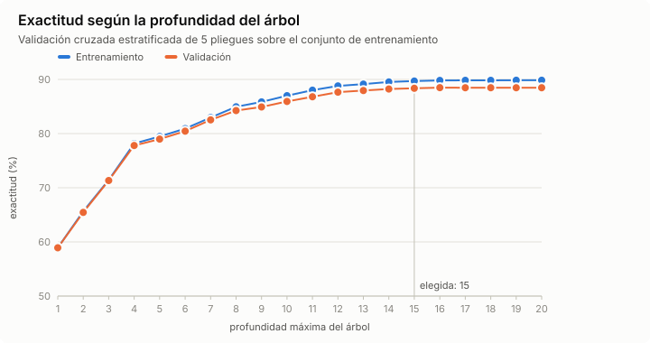
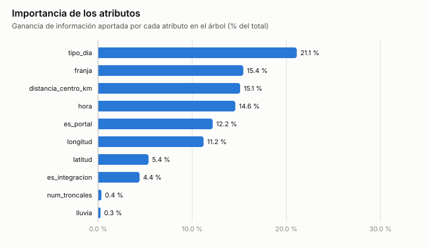
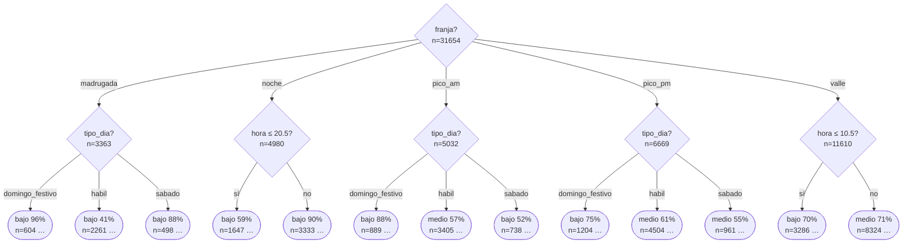

# Resultados - Actividad 3: árbol de decisión de demanda en TransMilenio

Generado el 2026-10-10 con `python -m actividad3 entrenar --datos muestra`.

## Datos

- Fuente: muestra sintética generada con semilla fija (`datos/afluencia_transmilenio_muestra.csv`).
- 45220 ejemplos (estación × hora) del 2026-03-02 al 2026-03-29, 85 estaciones.
- Etiqueta `nivel_demanda`: bajo (< 250 entradas/h), medio (250-799), alto (≥ 800).

| Clase | Ejemplos | % |
|---|---|---|
| bajo | 18354 | 40.6 % |
| medio | 20846 | 46.1 % |
| alto | 6020 | 13.3 % |

- Atributos: `hora`, `franja`, `tipo_dia`, `lluvia`, `es_portal`, `es_integracion`, `num_troncales`, `distancia_centro_km`, `latitud`, `longitud`.
- Criterio de división: **ganancia de información (ID3)**, mínimo 20 ejemplos por hoja.
- Partición estratificada: 70 % entrenamiento, 30 % prueba (semilla 42).

## Selección de la profundidad (validación cruzada)

Validación cruzada estratificada de 5 pliegues. Se elige la profundidad más pequeña cuya exactitud está a menos de un error estándar de la mejor.



| Profundidad | Exactitud entrenamiento | Exactitud validación |
|---|---|---|
| 1 | 58.9 % | 58.9 % |
| 2 | 65.6 % | 65.4 % |
| 3 | 71.4 % | 71.3 % |
| 4 | 78.2 % | 77.8 % |
| 5 | 79.5 % | 79.0 % |
| 6 | 80.9 % | 80.4 % |
| 7 | 83.0 % | 82.5 % |
| 8 | 85.0 % | 84.2 % |
| 9 | 85.8 % | 84.9 % |
| 10 | 87.0 % | 85.9 % |
| 11 | 88.0 % | 86.8 % |
| 12 | 88.8 % | 87.6 % |
| 13 | 89.1 % | 87.9 % |
| 14 | 89.5 % | 88.2 % |
| 15 | 89.7 % | 88.4 % |
| 16 | 89.8 % | 88.5 % |
| 17 | 89.8 % | 88.5 % |
| 18 | 89.8 % | 88.5 % |
| 19 | 89.8 % | 88.5 % |
| 20 | 89.8 % | 88.5 % |

**Profundidad elegida: 15.**

## Resultados en el conjunto de prueba

| Modelo | Exactitud | F1 macro |
|---|---|---|
| ZeroR (clase mayoritaria) | 46.1 % | 0.210 |
| OneR (atributo 'hora') | 63.7 % | 0.525 |
| Árbol de decisión (prof. 15) | 88.9 % | 0.886 |

El árbol tiene 648 nodos y 331 hojas (= 331 reglas), profundidad real 15.

### Métricas por clase (árbol)

| Clase | Precisión | Exhaustividad | F1 | Soporte |
|---|---|---|---|---|
| bajo | 0.902 | 0.903 | 0.903 | 5506 |
| medio | 0.878 | 0.882 | 0.880 | 6254 |
| alto | 0.883 | 0.865 | 0.874 | 1806 |

### Matriz de confusión (filas = real, columnas = predicha)

| real \ predicha | bajo | medio | alto |
|---|---|---|---|
| **bajo** | 4973 | 533 | 0 |
| **medio** | 527 | 5519 | 208 |
| **alto** | 11 | 232 | 1563 |

## Importancia de los atributos



| Atributo | Importancia |
|---|---|
| `tipo_dia` | 21.1 % |
| `franja` | 15.4 % |
| `distancia_centro_km` | 15.1 % |
| `hora` | 14.6 % |
| `es_portal` | 12.2 % |
| `longitud` | 11.2 % |
| `latitud` | 5.4 % |
| `es_integracion` | 4.4 % |
| `num_troncales` | 0.4 % |
| `lluvia` | 0.3 % |

## Primeros niveles del árbol



```text
(raíz) n=31654  ->  medio 46%
├── franja = madrugada  [bajo (58%, n=3363)]
│   ├── tipo_dia = domingo_festivo  [bajo (96%, n=604)]
│   │   ├── es_portal = no: bajo (100%, n=577)
│   │   └── es_portal = si: medio (59%, n=27)
│   ├── tipo_dia = habil  [bajo (41%, n=2261)]
│   │   ├── distancia_centro_km ≤ 7.52  [bajo (61%, n=1265)] ...
│   │   └── distancia_centro_km > 7.52  [alto (44%, n=996)] ...
│   └── tipo_dia = sabado  [bajo (88%, n=498)]
│       ├── es_portal = no  [bajo (92%, n=473)] ...
│       └── es_portal = si: medio (56%, n=25)
├── franja = noche  [bajo (80%, n=4980)]
│   ├── hora ≤ 20.5  [bajo (59%, n=1647)]
│   │   ├── tipo_dia = domingo_festivo: bajo (97%, n=276)
│   │   ├── tipo_dia = habil  [medio (53%, n=1128)] ...
│   │   └── tipo_dia = sabado: bajo (91%, n=243)
│   └── hora > 20.5  [bajo (90%, n=3333)]
│       ├── es_portal = no  [bajo (93%, n=3182)] ...
│       └── es_portal = si  [medio (68%, n=151)] ...
├── franja = pico_am  [medio (47%, n=5032)]
│   ├── tipo_dia = domingo_festivo  [bajo (88%, n=889)]
│   │   ├── es_portal = no  [bajo (93%, n=846)] ...
│   │   └── es_portal = si: medio (70%, n=43)
│   ├── tipo_dia = habil  [medio (57%, n=3405)]
│   │   ├── hora ≤ 7.5  [medio (51%, n=2274)] ...
│   │   └── hora > 7.5  [medio (69%, n=1131)] ...
│   └── tipo_dia = sabado  [bajo (52%, n=738)]
│       ├── es_portal = no  [bajo (54%, n=700)] ...
│       └── es_portal = si: alto (84%, n=38)
├── franja = pico_pm  [medio (54%, n=6669)]
│   ├── tipo_dia = domingo_festivo  [bajo (75%, n=1204)]
│   │   ├── es_portal = no  [bajo (78%, n=1156)] ...
│   │   └── es_portal = si: medio (77%, n=48)
│   ├── tipo_dia = habil  [medio (61%, n=4504)]
│   │   ├── distancia_centro_km ≤ 2.68  [alto (70%, n=945)] ...
│   │   └── distancia_centro_km > 2.68  [medio (69%, n=3559)] ...
│   └── tipo_dia = sabado  [medio (55%, n=961)]
│       ├── es_portal = no  [medio (57%, n=913)] ...
│       └── es_portal = si  [alto (67%, n=48)] ...
└── franja = valle  [medio (59%, n=11610)]
    ├── hora ≤ 10.5  [bajo (70%, n=3286)]
    │   ├── es_portal = no  [bajo (74%, n=3126)] ...
    │   └── es_portal = si  [medio (51%, n=160)] ...
    └── hora > 10.5  [medio (71%, n=8324)]
        ├── es_portal = no  [medio (74%, n=7933)] ...
        └── es_portal = si  [alto (92%, n=391)] ...
```

El árbol completo está en [arbol.txt](arbol.txt).

## Reglas de decisión

Cada hoja del árbol es una regla. Se muestran las 5 de mayor soporte por clase; las 331 reglas están en [reglas.txt](reglas.txt).

**Bajo**

```text
SI franja = noche Y hora > 20.5 Y es_portal = no Y distancia_centro_km > 5.695 ENTONCES bajo  [soporte 1817, confianza 100%]
SI franja = noche Y hora > 20.5 Y es_portal = no Y distancia_centro_km ≤ 5.695 Y latitud ≤ 4.62925 Y es_integracion = no ENTONCES bajo  [soporte 786, confianza 99%]
SI franja = pico_am Y tipo_dia = domingo_festivo Y es_portal = no Y es_integracion = no ENTONCES bajo  [soporte 773, confianza 96%]
SI franja = madrugada Y tipo_dia = domingo_festivo Y es_portal = no ENTONCES bajo  [soporte 577, confianza 100%]
SI franja = valle Y hora ≤ 9.5 Y es_portal = no Y es_integracion = no Y tipo_dia = habil Y latitud ≤ 4.68225 Y longitud ≤ -74.0578 Y distancia_centro_km > 2.555 ENTONCES bajo  [soporte 522, confianza 91%]
```

**Medio**

```text
SI franja = valle Y hora > 11.5 Y es_portal = no Y tipo_dia = habil Y es_integracion = no Y longitud > -74.1068 Y 0.52 < distancia_centro_km ≤ 15.96 Y lluvia = no ENTONCES medio  [soporte 1825, confianza 92%]
SI franja = valle Y hora > 11.5 Y es_portal = no Y tipo_dia = habil Y es_integracion = no Y longitud > -74.1068 Y distancia_centro_km > 0.52 Y lluvia = si ENTONCES medio  [soporte 1016, confianza 96%]
SI franja = pico_pm Y tipo_dia = habil Y distancia_centro_km > 2.68 Y es_portal = no Y latitud > 4.68675 ENTONCES medio  [soporte 964, confianza 97%]
SI franja = valle Y hora > 10.5 Y es_portal = no Y tipo_dia = sabado Y es_integracion = no Y longitud > -74.1068 ENTONCES medio  [soporte 781, confianza 93%]
SI franja = pico_pm Y tipo_dia = habil Y distancia_centro_km > 2.68 Y es_portal = no Y latitud ≤ 4.68675 Y longitud ≤ -74.1145 ENTONCES medio  [soporte 658, confianza 95%]
```

**Alto**

```text
SI franja = pico_pm Y tipo_dia = habil Y distancia_centro_km ≤ 2.68 Y longitud > -74.0761 ENTONCES alto  [soporte 376, confianza 88%]
SI franja = pico_pm Y tipo_dia = habil Y distancia_centro_km > 2.68 Y es_portal = no Y latitud ≤ 4.68675 Y longitud > -74.061 ENTONCES alto  [soporte 322, confianza 92%]
SI franja = pico_am Y tipo_dia = habil Y hora ≤ 6.5 Y distancia_centro_km > 7.925 Y longitud > -74.1192 Y latitud > 4.67625 ENTONCES alto  [soporte 302, confianza 96%]
SI franja = valle Y hora > 10.5 Y es_portal = si Y tipo_dia = habil ENTONCES alto  [soporte 271, confianza 97%]
SI franja = pico_am Y tipo_dia = habil Y hora ≤ 7.5 Y distancia_centro_km > 7.925 Y longitud ≤ -74.1192 ENTONCES alto  [soporte 242, confianza 100%]
```

### Línea base OneR

OneR elige el atributo `hora`:

```text
SI hora ≤ 5.5 ENTONCES bajo
SI 5.5 < hora ≤ 6.5 ENTONCES alto
SI 6.5 < hora ≤ 8.5 ENTONCES medio
SI 8.5 < hora ≤ 10.5 ENTONCES bajo
SI 10.5 < hora ≤ 19.5 ENTONCES medio
SI hora > 19.5 ENTONCES bajo
```

## Ejemplos de predicción explicada

- **Portal Norte**, 6:00, habil → **alto** (96% de 302 casos). Regla: `franja = pico_am Y tipo_dia = habil Y hora ≤ 6.5 Y distancia_centro_km > 7.925 Y longitud > -74.1192 Y latitud > 4.67625`
- **Calle 100**, 18:00, habil → **alto** (92% de 322 casos). Regla: `franja = pico_pm Y tipo_dia = habil Y distancia_centro_km > 2.68 Y es_portal = no Y latitud ≤ 4.68675 Y longitud > -74.061`
- **U. Nacional**, 13:00, sabado → **medio** (93% de 781 casos). Regla: `franja = valle Y hora > 10.5 Y es_portal = no Y tipo_dia = sabado Y es_integracion = no Y longitud > -74.1068`
- **Calle 45**, 21:00, domingo_festivo, con lluvia → **bajo** (100% de 69 casos). Regla: `franja = noche Y hora > 20.5 Y es_portal = no Y distancia_centro_km ≤ 5.695 Y latitud > 4.62925 Y tipo_dia = domingo_festivo`
