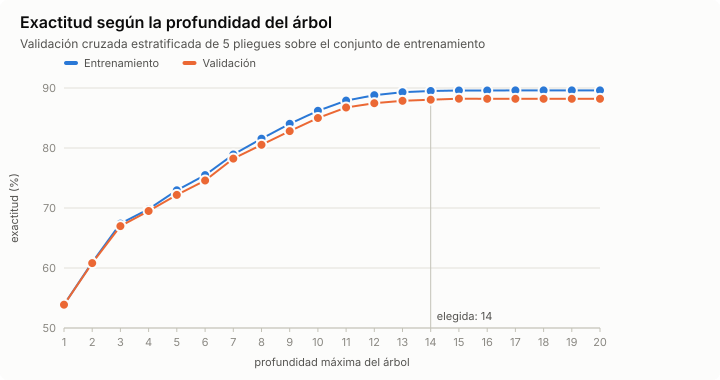
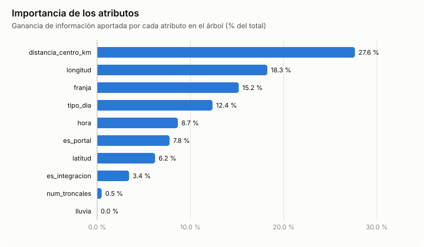
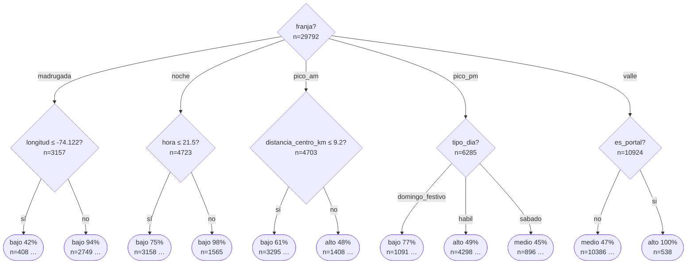

# Resultados - Actividad 3: árbol de decisión de demanda en TransMilenio

Generado el 2026-10-10 con `python -m actividad3 entrenar`.

## Datos

- Fuente: entradas y salidas cada 15 minutos publicadas por TRANSMILENIO S.A., sumadas por hora (`datos/afluencia_transmilenio_real.csv`).
- 42560 ejemplos (estación × hora) del 2026-03-02 al 2026-03-29, 80 estaciones.
- Etiqueta `nivel_demanda`: bajo (< 250 entradas/h), medio (250-799), alto (≥ 800).

| Clase | Ejemplos | % |
|---|---|---|
| bajo | 21304 | 50.1 % |
| medio | 13824 | 32.5 % |
| alto | 7432 | 17.5 % |

- Atributos: `hora`, `franja`, `tipo_dia`, `lluvia`, `es_portal`, `es_integracion`, `num_troncales`, `distancia_centro_km`, `latitud`, `longitud`.
- Criterio de división: **ganancia de información (ID3)**, mínimo 20 ejemplos por hoja.
- Partición estratificada: 70 % entrenamiento, 30 % prueba (semilla 42).

## Selección de la profundidad (validación cruzada)

Validación cruzada estratificada de 5 pliegues. Se elige la profundidad más pequeña cuya exactitud está a menos de un error estándar de la mejor.



| Profundidad | Exactitud entrenamiento | Exactitud validación |
|---|---|---|
| 1 | 53.9 % | 53.9 % |
| 2 | 60.9 % | 60.8 % |
| 3 | 67.4 % | 67.0 % |
| 4 | 69.8 % | 69.5 % |
| 5 | 72.9 % | 72.2 % |
| 6 | 75.5 % | 74.6 % |
| 7 | 78.9 % | 78.2 % |
| 8 | 81.5 % | 80.5 % |
| 9 | 84.0 % | 82.8 % |
| 10 | 86.2 % | 85.0 % |
| 11 | 87.9 % | 86.7 % |
| 12 | 88.8 % | 87.5 % |
| 13 | 89.3 % | 87.9 % |
| 14 | 89.5 % | 88.1 % |
| 15 | 89.6 % | 88.2 % |
| 16 | 89.6 % | 88.2 % |
| 17 | 89.6 % | 88.2 % |
| 18 | 89.6 % | 88.2 % |
| 19 | 89.6 % | 88.2 % |
| 20 | 89.6 % | 88.2 % |

**Profundidad elegida: 14.**

## Resultados en el conjunto de prueba

| Modelo | Exactitud | F1 macro |
|---|---|---|
| ZeroR (clase mayoritaria) | 50.1 % | 0.222 |
| OneR (atributo 'hora') | 55.3 % | 0.491 |
| Árbol de decisión (prof. 14) | 89.1 % | 0.883 |

El árbol tiene 662 nodos y 336 hojas (= 336 reglas), profundidad real 14.

### Métricas por clase (árbol)

| Clase | Precisión | Exhaustividad | F1 | Soporte |
|---|---|---|---|---|
| bajo | 0.917 | 0.937 | 0.927 | 6391 |
| medio | 0.842 | 0.830 | 0.836 | 4147 |
| alto | 0.904 | 0.870 | 0.887 | 2230 |

### Matriz de confusión (filas = real, columnas = predicha)

| real \ predicha | bajo | medio | alto |
|---|---|---|---|
| **bajo** | 5991 | 381 | 19 |
| **medio** | 516 | 3444 | 187 |
| **alto** | 24 | 265 | 1941 |

## Importancia de los atributos



| Atributo | Importancia |
|---|---|
| `distancia_centro_km` | 27.6 % |
| `longitud` | 18.3 % |
| `franja` | 15.2 % |
| `tipo_dia` | 12.4 % |
| `hora` | 8.7 % |
| `es_portal` | 7.8 % |
| `latitud` | 6.2 % |
| `es_integracion` | 3.4 % |
| `num_troncales` | 0.5 % |
| `lluvia` | 0.0 % |

## Primeros niveles del árbol



```text
(raíz) n=29792  ->  bajo 50%
├── franja = madrugada  [bajo (87%, n=3157)]
│   ├── longitud ≤ -74.122  [bajo (42%, n=408)]
│   │   ├── distancia_centro_km ≤ 7.66  [bajo (81%, n=160)] ...
│   │   └── distancia_centro_km > 7.66  [alto (54%, n=248)] ...
│   └── longitud > -74.122  [bajo (94%, n=2749)]
│       ├── distancia_centro_km ≤ 10.975: bajo (99%, n=2234)
│       └── distancia_centro_km > 10.975  [bajo (71%, n=515)] ...
├── franja = noche  [bajo (83%, n=4723)]
│   ├── hora ≤ 21.5  [bajo (75%, n=3158)]
│   │   ├── tipo_dia = domingo_festivo  [bajo (97%, n=574)] ...
│   │   ├── tipo_dia = habil  [bajo (68%, n=2133)] ...
│   │   └── tipo_dia = sabado  [bajo (84%, n=451)] ...
│   └── hora > 21.5: bajo (98%, n=1565)
├── franja = pico_am  [bajo (48%, n=4703)]
│   ├── distancia_centro_km ≤ 9.2  [bajo (61%, n=3295)]
│   │   ├── tipo_dia = domingo_festivo: bajo (98%, n=599)
│   │   ├── tipo_dia = habil  [medio (48%, n=2225)] ...
│   │   └── tipo_dia = sabado  [bajo (79%, n=471)] ...
│   └── distancia_centro_km > 9.2  [alto (48%, n=1408)]
│       ├── tipo_dia = domingo_festivo  [bajo (73%, n=248)] ...
│       ├── tipo_dia = habil  [alto (61%, n=972)] ...
│       └── tipo_dia = sabado  [medio (47%, n=188)] ...
├── franja = pico_pm  [alto (36%, n=6285)]
│   ├── tipo_dia = domingo_festivo  [bajo (77%, n=1091)]
│   │   ├── es_portal = no  [bajo (81%, n=1035)] ...
│   │   └── es_portal = si: alto (77%, n=56)
│   ├── tipo_dia = habil  [alto (49%, n=4298)]
│   │   ├── longitud ≤ -74.071  [medio (42%, n=2869)] ...
│   │   └── longitud > -74.071  [alto (74%, n=1429)] ...
│   └── tipo_dia = sabado  [medio (45%, n=896)]
│       ├── es_portal = no  [medio (47%, n=854)] ...
│       └── es_portal = si: alto (88%, n=42)
└── franja = valle  [medio (45%, n=10924)]
    ├── es_portal = no  [medio (47%, n=10386)]
    │   ├── tipo_dia = domingo_festivo  [bajo (83%, n=1876)] ...
    │   ├── tipo_dia = habil  [medio (54%, n=7010)] ...
    │   └── tipo_dia = sabado  [medio (54%, n=1500)] ...
    └── es_portal = si: alto (100%, n=538)
```

El árbol completo está en [arbol.txt](arbol.txt).

## Reglas de decisión

Cada hoja del árbol es una regla. Se muestran las 5 de mayor soporte por clase; las 336 reglas están en [reglas.txt](reglas.txt).

**Bajo**

```text
SI franja = madrugada Y longitud > -74.122 Y distancia_centro_km ≤ 10.975 ENTONCES bajo  [soporte 2234, confianza 99%]
SI franja = noche Y hora > 21.5 ENTONCES bajo  [soporte 1565, confianza 98%]
SI franja = valle Y es_portal = no Y tipo_dia = domingo_festivo Y -74.143 < longitud ≤ -74.0667 Y latitud > 4.606 Y 2.075 < distancia_centro_km ≤ 10.08 ENTONCES bajo  [soporte 841, confianza 97%]
SI franja = pico_am Y distancia_centro_km ≤ 9.2 Y tipo_dia = domingo_festivo ENTONCES bajo  [soporte 599, confianza 98%]
SI franja = noche Y hora ≤ 21.5 Y tipo_dia = domingo_festivo Y es_portal = no ENTONCES bajo  [soporte 551, confianza 99%]
```

**Medio**

```text
SI franja = valle Y es_portal = no Y tipo_dia = habil Y longitud ≤ -74.07 Y 4.62775 < latitud ≤ 4.6675 Y 5.71 < distancia_centro_km ≤ 8.64 Y hora ≤ 14.5 ENTONCES medio  [soporte 477, confianza 97%]
SI franja = valle Y es_portal = no Y tipo_dia = habil Y -74.093 < longitud ≤ -74.07 Y 4.62775 < latitud ≤ 4.6675 Y distancia_centro_km ≤ 5.71 ENTONCES medio  [soporte 363, confianza 89%]
SI franja = pico_am Y distancia_centro_km ≤ 9.2 Y tipo_dia = habil Y -74.143 < longitud ≤ -74.1115 ENTONCES medio  [soporte 352, confianza 88%]
SI franja = valle Y es_portal = no Y tipo_dia = habil Y longitud ≤ -74.07 Y latitud ≤ 4.61575 Y es_integracion = no Y distancia_centro_km ≤ 1.665 Y hora > 10.5 ENTONCES medio  [soporte 332, confianza 88%]
SI franja = valle Y es_portal = no Y tipo_dia = habil Y longitud ≤ -74.0898 Y latitud > 4.6675 Y 10.08 < distancia_centro_km ≤ 12.445 Y hora ≤ 13.5 ENTONCES medio  [soporte 316, confianza 99%]
```

**Alto**

```text
SI franja = pico_pm Y tipo_dia = habil Y longitud > -74.067 Y hora ≤ 18.5 Y distancia_centro_km ≤ 13.495 ENTONCES alto  [soporte 674, confianza 97%]
SI franja = valle Y es_portal = si ENTONCES alto  [soporte 538, confianza 100%]
SI franja = valle Y es_portal = no Y tipo_dia = habil Y longitud > -74.07 Y 3.075 < distancia_centro_km ≤ 7.6 Y hora > 11.5 ENTONCES alto  [soporte 305, confianza 98%]
SI franja = pico_am Y 10.975 < distancia_centro_km ≤ 15.27 Y tipo_dia = habil Y longitud > -74.1178 Y hora ≤ 7.5 ENTONCES alto  [soporte 236, confianza 95%]
SI franja = pico_pm Y tipo_dia = habil Y longitud ≤ -74.071 Y hora ≤ 17.5 Y distancia_centro_km ≤ 7.375 Y latitud > 4.64175 ENTONCES alto  [soporte 220, confianza 99%]
```

### Línea base OneR

OneR elige el atributo `hora`:

```text
SI hora ≤ 10.5 ENTONCES bajo
SI 10.5 < hora ≤ 15.5 ENTONCES medio
SI 15.5 < hora ≤ 18.5 ENTONCES alto
SI hora > 18.5 ENTONCES bajo
```

## Ejemplos de predicción explicada

- **Portal Norte**, 6:00, habil → **alto** (100% de 83 casos). Regla: `franja = pico_am Y distancia_centro_km > 15.96 Y tipo_dia = habil Y longitud > -74.1178`
- **Calle 100**, 18:00, habil → **alto** (97% de 674 casos). Regla: `franja = pico_pm Y tipo_dia = habil Y longitud > -74.067 Y hora ≤ 18.5 Y distancia_centro_km ≤ 13.495`
- **U. Nacional**, 13:00, sabado → **medio** (92% de 99 casos). Regla: `franja = valle Y es_portal = no Y tipo_dia = sabado Y -74.081 < longitud ≤ -74.067 Y latitud > 4.62975 Y es_integracion = no Y hora > 10.5`
- **Calle 45**, 21:00, domingo_festivo, con lluvia → **bajo** (99% de 551 casos). Regla: `franja = noche Y hora ≤ 21.5 Y tipo_dia = domingo_festivo Y es_portal = no`
