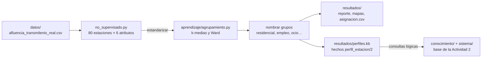
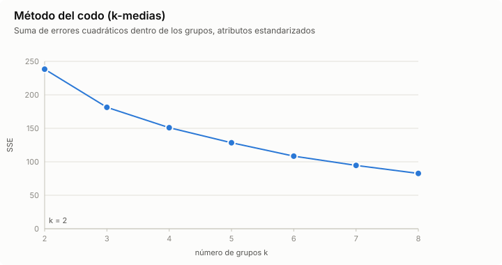
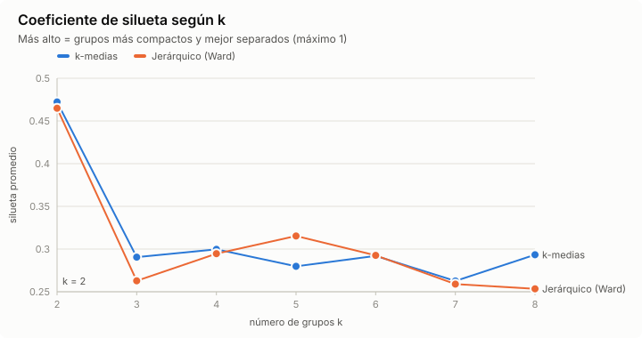
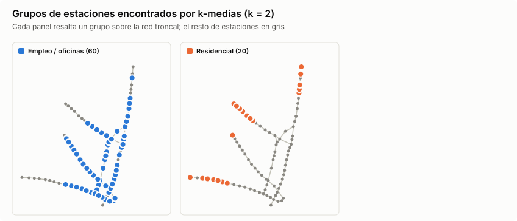
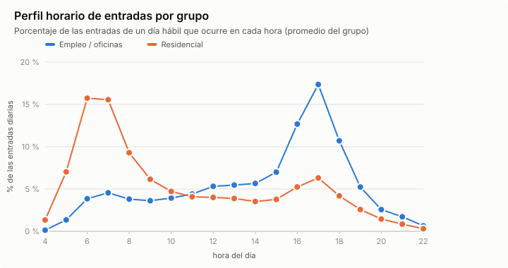
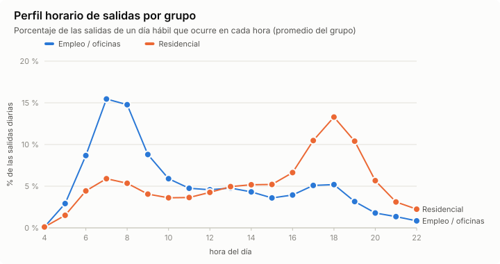
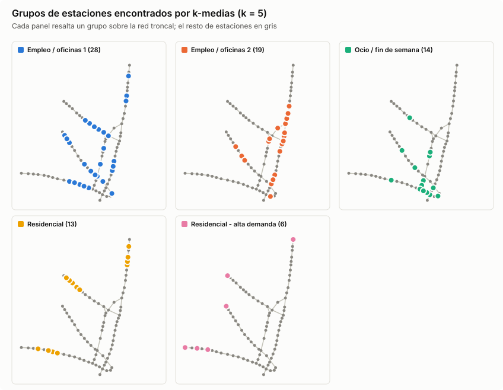
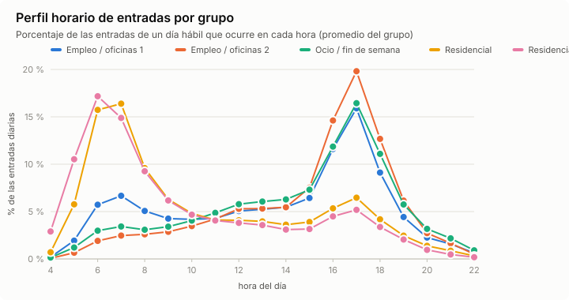
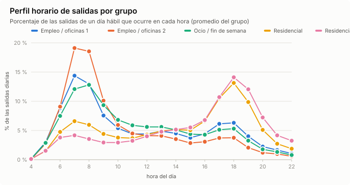
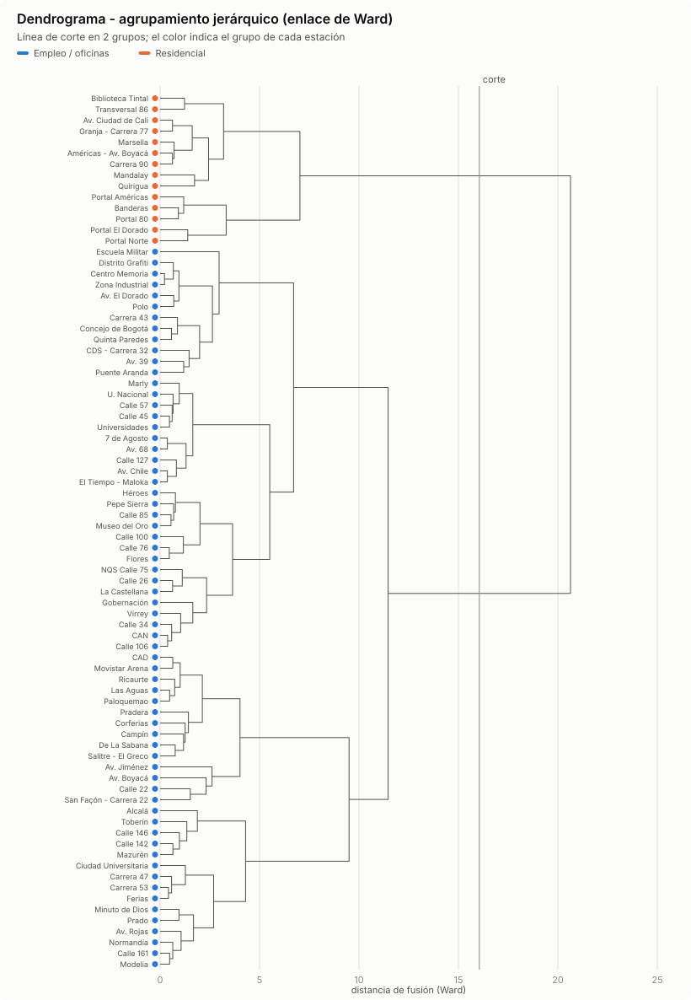

# Actividad 4 · Aprendizaje no supervisado: tipos de estación de TransMilenio

Inteligencia Artificial · Ingeniería de Software · Corporación Universitaria Iberoamericana.
Continúa el proyecto de la [Actividad 2](../README.md) (ruta óptima con base de conocimiento y A\*) y usa los mismos datos de la [Actividad 3](../actividad3/README.md).

## Objetivo

Descubrir, **sin ninguna etiqueta**, qué tipos de estación existen en la red según su **patrón de uso real**:
- a qué hora entra y sale la gente;
- cuánto se usa el fin de semana;
- qué tan grande es su demanda.

Se aplican las **técnicas de agrupamiento** del cap. 16 (Palma Méndez, 2008), implementadas desde cero en Python y sin librerías externas:
- **k-medias**;
- **agrupamiento jerárquico aglomerativo** con enlace de Ward.

Los datos son las entradas y salidas reales de TRANSMILENIO del 2 al 29 de marzo de 2026. Los grupos encontrados vuelven a la **base de conocimiento** de la Actividad 2 como hechos lógicos.

Para qué sirve:
- **Planeación:** las estaciones de origen necesitan buses vacíos en la mañana hacia el centro; las de destino, en la tarde.
- **Análisis de fallas:** cerrar una estación de destino de alta demanda no tiene el mismo efecto que cerrar una pequeña.
- **Comunicación:** los perfiles horarios de cada grupo se pueden usar para informar a los usuarios.

## Qué hay en esta carpeta

`actividad4/` reúne los **comandos**, la **documentación** y los **resultados** del aprendizaje no supervisado. Usa los mismos datos de la Actividad 3 y los algoritmos de la biblioteca compartida `aprendizaje/`.



| Archivo o carpeta | Qué es | Cómo se genera o se usa |
|---|---|---|
| `README.md` | Este documento: fuentes, atributos, algoritmos, comandos, resultados, interpretación y limitaciones. | Se escribe a mano. |
| [`no_supervisado.py`](no_supervisado.py) | Los comandos de la actividad. Resume las validaciones de cada estación en un vector de 6 atributos, ejecuta k-medias y Ward, elige k, nombra y compara los grupos y exporta los hechos lógicos. | `python -m actividad4 <comando>`: `importar`, `generar`, `explorar`, `codo`, `agrupar` (sección 4). |
| `__main__.py`, `__init__.py` | Hacen de la carpeta un paquete ejecutable. | Permiten escribir `python -m actividad4`. |
| [`resultados/`](resultados/reporte.md) | Datos reales con el k que elige la silueta (k = 2). | `python -m actividad4 agrupar` |
| [`resultados/k5/`](resultados/k5/reporte.md) | Datos reales con k = 5, la tipología más fina. | `python -m actividad4 agrupar -k 5` |
| [`resultados/muestra/`](resultados/muestra/reporte.md) | Muestra sintética, con el k que elige su silueta (k = 5). | `python -m actividad4 agrupar --datos muestra` |

Cada carpeta de resultados tiene los mismos nueve archivos:

| Archivo | Contenido |
|---|---|
| `reporte.md` | Reporte completo: atributos, elección de k, grupos, comparación con Ward y con la vocación supuesta, y consulta lógica. |
| `codo.svg`, `silueta.svg` | SSE y silueta para k = 2 … 8, con el k usado marcado. |
| `mapa_clusters.svg` | Un mapa de la red por grupo, con sus estaciones resaltadas. |
| `perfiles_entradas.svg`, `perfiles_salidas.svg` | Perfil horario promedio de entradas y de salidas de cada grupo. |
| `dendrograma.svg` | Dendrograma de Ward con la línea de corte. |
| `asignacion.csv` | El grupo de cada estación con k-medias y con Ward, y sus 6 atributos. |
| `perfiles.kb` | Hechos `perfil_estacion(Estacion, Perfil).` que se cargan en la base de conocimiento. |

Lo que usa de otras carpetas:

| Carpeta | Qué toma de ahí |
|---|---|
| [`datos/`](../datos/) | Los mismos CSV de la Actividad 3: `afluencia_transmilenio_real.csv` (lo crea `importar`) y `afluencia_transmilenio_muestra.csv` (lo crea `generar`). |
| [`aprendizaje/`](../aprendizaje/) | `agrupamiento.py`: estandarización, k-medias++, jerárquico, silueta e índice de Rand ajustado. `datos_reales.py` y `datos.py`: datos, atributos de estación y vocación supuesta de la muestra. `graficos.py` y `salida.py`: gráficos SVG y tablas. |
| [`conocimiento/`](../conocimiento/) y [`sistema/`](../sistema/) | Coordenadas y tramos para dibujar la red en el mapa. El motor de inferencia carga `perfiles.kb` y responde consultas como `perfil_estacion(E, P), estacion_de_integracion(E)`. |
| [`tests/`](../tests/) | `test_agrupamiento.py` (15 pruebas). Los datos se prueban en `test_datos_reales.py` y `test_datos.py`. Pruebas avanzadas: `test_aprendizaje_avanzado.py` compara los cuatro enlaces, la silueta y el índice de Rand ajustado con su definición y revisa propiedades de k-medias; `test_reproducibilidad.py` vuelve a ejecutar `agrupar` y comprueba que genera los mismos archivos de `resultados/`. |

## 1. Fuentes de datos identificadas

| Fuente | Publica | Qué contiene | Uso en el proyecto |
|---|---|---|---|
| [Validaciones mensuales troncales](https://storage.googleapis.com/validaciones_tmsa/validaciones_mensuales.html) | TRANSMILENIO S.A., repositorio de datos abiertos [`validaciones_tmsa`](https://storage.googleapis.com/validaciones_tmsa/index.html) | Un XLSX por mes, de 2012 a 2026, con las validaciones de ingreso por estación, acceso e intervalo de 15 minutos. Trae una columna por día del mes. | Entradas por estación y hora: perfil horario de **entradas** y volumen. |
| [Salidas mensuales](https://storage.googleapis.com/validaciones_tmsa/salidas_mensuales.html) | TRANSMILENIO S.A., mismo repositorio | Lo mismo para los torniquetes de salida. [Datos Abiertos Bogotá](https://datosabiertos.bogota.gov.co/dataset/consolidado-de-salidas-sistema-troncal-por-franja-horaria) lo publica además como CSV de 2020 a noviembre de 2024 (CC BY 4.0). | Perfil horario de **salidas**: dónde llega la gente. |
| [Validaciones diarias](https://storage.googleapis.com/validaciones_tmsa/validaciones_diarias.html) | TRANSMILENIO S.A., mismo repositorio | Un registro por transacción (21 campos, entre ellos `Numero_Tarjeta`). | No se usa: los agregados bastan y así no hay que manejar números de tarjeta. |
| [Estaciones Troncales de TRANSMILENIO](https://datosabiertos.bogota.gov.co/dataset/estaciones-troncales-de-transmilenio1) | TRANSMILENIO S.A. en Datos Abiertos Bogotá (CC BY 4.0) | Ubicación de las paradas troncales. | Catálogo y mapa. Aquí se usan las 85 estaciones y coordenadas de la base de conocimiento. |
| [Trazados Troncales](https://datosabiertos.bogota.gov.co/dataset/trazados-troncales-de-transmilenio) y [GTFS](https://datosabiertos-transmilenio.hub.arcgis.com/) | TRANSMILENIO S.A. (CC BY 4.0) | Trazado de las troncales, servicios y horarios. | Dibujar la red en el mapa. Aquí se usan los hechos `siguiente/3` de la base de conocimiento. |
| [Encuesta de Movilidad 2023](https://www.simur.gov.co/encuestas-de-movilidad) | Secretaría Distrital de Movilidad (SIMUR) | Encuesta origen-destino con zonificación (UTAM, ZAT). | Validar externamente los grupos con datos reales: las zonas residenciales generan viajes en la mañana; las de empleo los atraen. |
| [Datos Abiertos Bogotá](https://datosabiertos.bogota.gov.co/) | Plataforma distrital (Catastro Distrital, IDECA) | Información geográfica y sectorial (grupo temático *Transporte*). | Uso del suelo alrededor de cada estación, para interpretar los grupos. |

El conversor de los reportes está descrito en la [Actividad 3, sección 2.1](../actividad3/README.md#21-datos-reales-base-del-modelo); es el mismo comando:

```bash
python -m actividad4 importar         # crea datos/afluencia_transmilenio_real.csv (ya incluido en el repositorio)
```

Resumen:
- 80 de las 85 estaciones de la base de conocimiento tienen datos.
- Calle 19, Calle 63, Calle 72 y Tercer Milenio estaban cerradas por las obras del metro en la Caracas, y Patio Bonito no aparece en los reportes.
- La suma del conversor coincide con los totales diarios oficiales de TRANSMILENIO en los 31 días de marzo.

**Muestra sintética.** Se conserva la [muestra del proyecto](../actividad3/README.md#22-muestra-sintética-respaldo-y-verdad-conocida), con las mismas columnas y las 85 estaciones, como **verdad conocida**: cada estación tiene una vocación oculta con la que se generaron sus datos. Con `--datos muestra` se repite todo el análisis sobre ella; los resultados quedan en [`resultados/muestra/`](resultados/muestra/reporte.md).

## 2. De validaciones a un vector por estación

El aprendizaje no supervisado necesita **un ejemplo por estación**. Cada estación se resume con 6 atributos calculados sobre los **días hábiles**. La media y la desviación se calculan sobre las 80 estaciones reales:

| Atributo | Descripción | Media | Desv. |
|---|---|---|---|
| `log_volumen` | log10 de las entradas de un día hábil promedio | 3,949 | 0,350 |
| `pico_am_entradas` | fracción de las entradas del día que ocurre entre 5:00 y 8:59 | 0,221 | 0,174 |
| `pico_pm_entradas` | fracción de las entradas del día que ocurre entre 16:00 y 19:59 | 0,390 | 0,143 |
| `pico_am_salidas` | fracción de las salidas del día que ocurre entre 6:00 y 9:59 | 0,407 | 0,146 |
| `pico_pm_salidas` | fracción de las salidas del día que ocurre entre 17:00 y 20:59 | 0,214 | 0,122 |
| `ratio_fin_de_semana` | entradas de un día de fin de semana o festivo ÷ entradas de un día hábil | 0,381 | 0,107 |

Decisiones:
- **Fracciones, no conteos.** Así un portal y una estación pequeña con el mismo *patrón* quedan cerca. El tamaño se representa aparte con `log_volumen`; el logaritmo evita que los portales dominen.
- **Las salidas se miden una hora más tarde que las entradas**, porque el viaje dura alrededor de una hora.
- **Estandarización z** (media 0, desviación 1) antes de agrupar. Sin ella, la distancia euclidiana la dominaría el atributo de mayor escala.

Ya en las medias se ve un rasgo de la red real: para la estación típica, la mañana concentra el 41 % de sus salidas pero solo el 22 % de sus entradas. La mayoría de estaciones son destinos de la mañana; los orígenes se concentran en pocas estaciones grandes.

## 3. Algoritmos (cap. 16)

Implementación en [`aprendizaje/agrupamiento.py`](../aprendizaje/agrupamiento.py):

- **k-medias** (MacQueen, 1967):
  1. Asigna cada estación al centroide más cercano.
  2. Recalcula los centroides.
  3. Repite hasta que nada cambia.
  - Inicialización **k-medias++** (Arthur y Vassilvitskii, 2007): cada centro nuevo se elige con probabilidad proporcional a D(x)².
  - Se hacen 10 reinicios y se conserva el de menor SSE (suma de errores cuadráticos).
- **Agrupamiento jerárquico aglomerativo:**
  - Empieza con cada estación como su propio grupo y une repetidamente los dos grupos más cercanos.
  - Las distancias se actualizan con la fórmula de **Lance-Williams**. Hay enlace simple, completo, promedio y **Ward**; Ward une los grupos que menos aumentan la varianza interna.
  - El resultado es un **dendrograma** que se corta en k grupos.
  - Las alturas de fusión y los cortes coinciden exactamente con los de `scipy.cluster.hierarchy`, comprobado con la muestra y con los datos reales.
- **Elección de k:**
  - **Método del codo:** dónde deja de bajar rápido la SSE.
  - **Coeficiente de silueta** (Rousseeuw, 1987): `s = (b − a) / max(a, b)`, entre −1 y 1. Compara qué tan cerca está cada estación de su grupo frente al grupo vecino.
- **Validación:**
  - Concordancia entre k-medias y Ward con el **índice de Rand ajustado** (Hubert y Arabie, 1985): 1 = particiones idénticas, ~0 = como al azar.
  - Comparación con la **vocación supuesta** al generar la muestra. Con la muestra es la verdad conocida; con los datos reales sirve para comprobar si esos supuestos se cumplen.
- **Interpretación automática:**
  - Cada grupo recibe un nombre a partir de su centroide, con el índice residencial
    `(entradas AM − entradas PM) + (salidas PM − salidas AM)`.
    - Positivo: la gente sale en la mañana y vuelve en la tarde (**residencial**, origen).
    - Negativo: la gente llega en la mañana y se va en la tarde (**empleo / oficinas**, destino).
  - Un uso en fin de semana muy por encima del resto indica **ocio / fin de semana**: comercio, estadios, eventos.
  - Un volumen muy alto añade **alta demanda**.
  - Si dos grupos reciben el mismo nombre, se numeran.

## 4. Comandos

Requisitos: Python 3.8 o superior y la librería rich para la consola (`pip install -r requirements.txt`). Se ejecutan desde la raíz del repositorio.

También se pueden usar desde el menú de `python main.py` (opción 4, «Tipos de estación»). Allí la opción «Consultar los perfiles de estación» carga `perfiles.kb` y lo consulta junto con las reglas de la Actividad 2. Otra forma equivalente es `python main.py actividad4 COMANDO`.

| Comando | Qué hace |
|---|---|
| `python -m actividad4 explorar` | Atributos de cada estación y su perfil horario. |
| `python -m actividad4 codo` | SSE y silueta para k = 2 … 8, con sus gráficos. |
| `python -m actividad4 agrupar` | Usa el k de mayor silueta. Ejecuta k-medias y Ward, nombra los grupos, los compara y guarda en [`resultados/`](resultados/) el [reporte](resultados/reporte.md), los gráficos, la asignación de cada estación ([`asignacion.csv`](resultados/asignacion.csv)) y los hechos lógicos ([`perfiles.kb`](resultados/perfiles.kb)). Tarda alrededor de 2 s. |
| `python -m actividad4 agrupar -k 5` | Lo mismo con k fijo; los resultados van a [`resultados/k5/`](resultados/k5/reporte.md) para no sobrescribir los anteriores. |

Todos aceptan `--datos muestra` para trabajar sobre la muestra sintética.

```bash
python -m actividad4 explorar
```

```text
80 estaciones descritas por 6 atributos ────────────────────────────────────────────────────────────
Días hábiles, datos reales de TRANSMILENIO
log vol.  log_volumen: log10 de las entradas de un día hábil promedio
AM ent.   pico_am_entradas: fracción de las entradas del día hábil entre 5:00 y 8:59
PM ent.   pico_pm_entradas: fracción de las entradas del día hábil entre 16:00 y 19:59
AM sal.   pico_am_salidas: fracción de las salidas del día hábil entre 6:00 y 9:59
PM sal.   pico_pm_salidas: fracción de las salidas del día hábil entre 17:00 y 20:59
Fin sem.  ratio_fin_de_semana: entradas de un día de fin de semana o festivo / entradas de un día
          hábil

Estación             Entradas/día  AM ent.  PM ent.  AM sal.  PM sal.  Fin sem.  Perfil 4h-22h
────────────────────────────────────────────────────────────────────────────────────────────────────
7 de Agosto                 9.214    0.115    0.454    0.455    0.153     0.395  ▁▁▂▂▂▂▂▂▄▃▃▄▆█▆▃▂▁▁
Alcalá                     22.087    0.319    0.351    0.379    0.265     0.348  ▁▂▆▇▅▃▃▃▃▃▃▄▇█▅▃▂▁▁
Américas - Av.              5.678    0.410    0.199    0.205    0.349     0.434  ▁▃█▇▅▄▃▃▃▃▃▃▃▄▃▂▁▁▁
…
```

```bash
python -m actividad4 codo
```

```text
Número de grupos: codo y silueta para k = 2 a 8 ────────────────────────────────────────
datos reales de TRANSMILENIO
╭───┬────────────────┬──────────────────┬──────────────╮
│ k │ SSE (k-medias) │ Silueta k-medias │ Silueta Ward │
├───┼────────────────┼──────────────────┼──────────────┤
│ 2 │          238.3 │            0.472 │        0.465 │
│ 3 │          181.3 │            0.291 │        0.263 │
│ 4 │          151.0 │            0.300 │        0.295 │
│ 5 │          128.5 │            0.280 │        0.315 │
│ 6 │          108.5 │            0.292 │        0.293 │
│ 7 │           94.6 │            0.263 │        0.259 │
│ 8 │           82.6 │            0.293 │        0.253 │
╰───┴────────────────┴──────────────────┴──────────────╯
k con mayor silueta (k-medias): 2
Gráficos: actividad4/resultados/codo.svg, silueta.svg
```

## 5. Resultados (datos reales)





**Elección de k:**
- La silueta elige con claridad **k = 2** (0,472).
- Desde k = 3 cae a cerca de 0,3 y la SSE baja de forma pareja, sin un codo marcado.
- En la escala de Kaufman y Rousseeuw (1990), una silueta entre 0,26 y 0,50 indica una estructura **débil**: las estaciones reales forman un continuo entre "origen" y "destino", no tipos puros.
- En la muestra sintética la silueta llegaba a 0,597 con k = 5, porque se generó a partir de cuatro vocaciones definidas.

### k = 2: origen frente a destino

| Grupo (k-medias) | Estaciones | Entradas/día | Entradas AM | Entradas PM | Salidas AM | Salidas PM | Fin de semana |
|---|---|---|---|---|---|---|---|
| 1. Empleo / oficinas (destino) | 60 | 7.901 | 0,14 | 0,46 | 0,48 | 0,15 | 0,36 |
| 2. Residencial (origen) | 20 | 12.674 | 0,48 | 0,18 | 0,20 | 0,40 | 0,44 |

- **Residencial (20):** los portales (Portal 80, Portal Américas, Portal El Dorado, Portal Norte) y las estaciones de la periferia:
  - Américas: Banderas, Biblioteca Tintal, Transversal 86, Mandalay, Marsella, Américas - Av. Boyacá.
  - Calle 80 occidental: Quirigua, Carrera 90, Av. Ciudad de Cali, Granja - Carrera 77, Minuto de Dios, Av. Boyacá.
  - Extremo norte: Toberín, Mazurén, Calle 142, Calle 146.
- **Empleo / oficinas (60):** todas las demás. Reciben gente en la mañana y la despachan en la tarde.







Las dos curvas son casi espejos: el grupo residencial concentra el 48 % de sus entradas entre 5:00 y 8:59; el de destino, el 46 % entre 16:00 y 19:59.

### k = 5: una tipología más fina

Con `-k 5` (silueta 0,280 con k-medias y 0,315 con Ward) aparecen subtipos interpretables. Es el mismo número de grupos que la muestra, así que sirve para compararlas:

| Grupo (k-medias) | Estaciones | Entradas/día | Entradas AM | Entradas PM | Salidas AM | Salidas PM | Fin de semana |
|---|---|---|---|---|---|---|---|
| 1. Empleo / oficinas 1 | 28 | 5.807 | 0,19 | 0,41 | 0,44 | 0,19 | 0,35 |
| 2. Empleo / oficinas 2 | 19 | 11.583 | 0,08 | 0,53 | 0,57 | 0,11 | 0,27 |
| 3. Ocio / fin de semana | 14 | 8.785 | 0,11 | 0,45 | 0,42 | 0,15 | 0,53 |
| 4. Residencial | 13 | 7.293 | 0,47 | 0,18 | 0,22 | 0,39 | 0,40 |
| 5. Residencial - alta demanda | 6 | 44.437 | 0,52 | 0,15 | 0,14 | 0,44 | 0,48 |

- **Empleo / oficinas 2: destino fuerte.**
  - Estaciones: Av. 39, Av. Chile, CAN, Calle 100, Calle 106, Calle 127, Calle 26, Calle 34, Calle 76, Calle 85, El Tiempo - Maloka, Flores, Gobernación, Héroes, La Castellana, Museo del Oro, NQS Calle 75, Pepe Sierra, Virrey.
  - Solo el 8 % de sus entradas ocurre en la mañana y el fin de semana cae al 27 %: son zonas de oficinas.
- **Empleo / oficinas 1: destino moderado y estaciones más pequeñas.**
  - Estaciones: 7 de Agosto, Alcalá, Av. 68, Av. El Dorado, Av. Rojas, CDS - Carrera 32, Calle 161, Calle 45, Calle 57, Carrera 43, Carrera 47, Carrera 53, Centro Memoria, Ciudad Universitaria, Concejo de Bogotá, Distrito Grafiti, Escuela Militar, Ferias, Marly, Modelia, Normandía, Polo, Prado, Puente Aranda, Quinta Paredes, U. Nacional, Universidades, Zona Industrial.
- **Ocio / fin de semana:** un sábado o domingo conservan el 53 % del uso de un día hábil.
  - Estaciones: Av. Boyacá, Av. Jiménez, CAD, Calle 22, Campín, Corferias, De La Sabana, Las Aguas, Movistar Arena, Paloquemao, Pradera, Ricaurte, Salitre - El Greco, San Façón - Carrera 22.
  - Son centros comerciales (Av. Boyacá junto a Titán Plaza, Pradera – Plaza Central, Salitre – El Greco), escenarios de eventos (Campín, Movistar Arena, Corferias), la plaza de Paloquemao y el comercio del centro (Av. Jiménez, San Façón, Ricaurte).
- **Residencial:** Américas - Av. Boyacá, Av. Ciudad de Cali, Calle 142, Calle 146, Carrera 90, Granja - Carrera 77, Mandalay, Marsella, Mazurén, Minuto de Dios, Quirigua, Toberín, Transversal 86.
- **Residencial - alta demanda:** Banderas, Biblioteca Tintal y los cuatro portales, con unas 44.000 entradas en un día hábil.







### k-medias frente a jerárquico (Ward)



| Medida | k = 2 | k = 5 |
|---|---|---|
| Silueta k-medias / Ward | 0,472 / 0,465 | 0,280 / 0,315 |
| Concordancia k-medias vs. Ward (índice de Rand ajustado) | 0,688 | 0,488 |
| Estaciones asignadas distinto | 6 | 24 |

- **Con k = 2 los métodos coinciden en 74 de las 80 estaciones.** Solo discrepan seis de la frontera entre origen y destino: Av. Boyacá, Calle 142, Calle 146, Mazurén, Minuto de Dios y Toberín.
- **Con k = 5 la concordancia baja a 0,488**, lo esperable cuando los grupos se traslapan. Ward logra una silueta algo mejor que k-medias. El dendrograma de k = 5 está en [`resultados/k5/dendrograma.svg`](resultados/k5/dendrograma.svg).

### ¿Se cumplen los supuestos de la muestra?

La muestra sintética supuso una vocación para cada estación:
- **empleo** o **educativa / ocio**, según una lista de atractores;
- **residencial**, si es portal o está a más de 7,5 km del centro;
- **mixta**, en otro caso.

Esa vocación **no** se usó para agrupar. La tabla la compara con los grupos reales (k = 5):

| Grupo real \ vocación supuesta | residencial | empleo | educativa_ocio | mixta |
|---|---|---|---|---|
| Empleo / oficinas 1 | 12 | 3 | 5 | 8 |
| Empleo / oficinas 2 | 4 | 10 | 0 | 5 |
| Ocio / fin de semana | 1 | 5 | 4 | 4 |
| Residencial | 10 | 0 | 0 | 3 |
| Residencial - alta demanda | 6 | 0 | 0 | 0 |

- **Acertó con el empleo.** Las 18 estaciones supuestas de empleo con datos quedan todas en grupos de destino, 10 de ellas en el de destino fuerte.
- **Falló con la frontera residencial.** De las 33 supuestas residenciales solo 16 lo son en la realidad.
  - El corredor norte (Calle 106, Calle 127, Pepe Sierra, Alcalá, Prado, Calle 161) y la Calle 80 central (Av. 68, Ferias, Carreras 47 y 53, Escuela Militar, Polo) atraen viajes aunque estén lejos del centro.
  - La distancia por sí sola no define una zona residencial.
- **Falló con las universidades.**
  - U. Nacional, Universidades y Ciudad Universitaria se comportan como destinos de entre semana: su uso en fin de semana es de 0,33 a 0,39.
  - El uso alto en fin de semana es de los centros comerciales, los estadios y el comercio del centro: Av. Jiménez llega a 0,72.
- El índice de Rand ajustado frente a la vocación supuesta es bajo: 0,070 con k-medias y 0,098 con Ward.

Sobre la muestra, donde la vocación sí es la verdad, el mismo método la recupera casi por completo:
- índice de Rand ajustado de 0,829 con k-medias y 0,879 con Ward;
- silueta de 0,597.

Ver [`resultados/muestra/reporte.md`](resultados/muestra/reporte.md). El método funciona; lo que cambia es que la ciudad real no se ajusta a los cuatro tipos supuestos.

### De vuelta a la base de conocimiento

Los grupos se exportan como hechos en la sintaxis de la Actividad 2 ([`resultados/perfiles.kb`](resultados/perfiles.kb) con k = 2 y [`resultados/k5/perfiles.kb`](resultados/k5/perfiles.kb) con k = 5):

```prolog
perfil_estacion("Portal Norte", "residencial_alta_demanda").
perfil_estacion("Calle 100", "empleo_2").
```

Luego se consultan junto con las reglas del sistema experto. Por ejemplo, el perfil (k = 5) de las estaciones de integración, que la base de conocimiento **infiere** con las reglas R12/R13:

```text
perfil_estacion(E, P), estacion_de_integracion(E)
  Av. Jiménez: ocio_fin_de_semana
  Calle 100: empleo_2
  Escuela Militar: empleo_1
  Héroes: empleo_2
  Las Aguas: ocio_fin_de_semana
  Ricaurte: ocio_fin_de_semana
  Universidades: empleo_1
```

Con k = 2 las siete estaciones de integración son de destino (`empleo`): ninguna es un origen residencial.

## 6. Interpretación

- **El algoritmo encontró la estructura de la ciudad sin etiquetas.**
  - El eje más fuerte, el único con silueta clara, es **origen → destino**.
  - De un lado, 20 estaciones residenciales: portales y periferia occidental y norte.
  - Del otro, 60 estaciones que reciben gente en la mañana.
  - En la red real hay muchos más destinos que orígenes: pocos portales enormes alimentan a muchas estaciones medianas.
- **Los portales se separan por volumen, no por patrón.** Tienen el mismo perfil residencial que la periferia, con unas 6 veces más demanda (44.437 frente a 7.293 entradas por día hábil con k = 5).
- **El fin de semana revela el comercio y el ocio:**
  - centros comerciales: Titán Plaza junto a Av. Boyacá, Plaza Central junto a Pradera, El Greco;
  - estadios y recintos: Campín, Movistar Arena, Corferias;
  - la plaza de Paloquemao y el comercio del centro.
- **La muestra sintética acertó en la forma, no en los detalles.**
  - El patrón casa-trabajo existe y los atractores de empleo supuestos son correctos.
  - Pero la periferia norte y la Calle 80 central son destinos, y las universidades no son de fin de semana.
  - Eso solo se pudo ver con los datos reales.
- **Ward y k-medias coinciden en la partición fuerte (k = 2) y discrepan en la fina (k = 5).** Es una señal más de que los subtipos son útiles para describir, pero no son grupos nítidos.

## 7. Limitaciones

- **Un solo mes de datos** (4 semanas de marzo de 2026). En vacaciones las universidades y los colegios cambiarían su perfil.
- **Obras del metro:** cuatro estaciones de la Caracas estaban cerradas y cinco operaban como temporales, así que su perfil puede no ser el habitual.
- **k-medias tiene sesgos de forma y escala:** supone grupos de forma esférica y tamaño parecido, y depende de la escala de los atributos (por eso la estandarización) y de la inicialización (por eso k-medias++ y 10 reinicios). Con una estructura débil, como la real, estos sesgos pesan más.
- **Solo 6 atributos.** Usar los 19 valores horarios completos daría más detalle, pero sería más difícil de interpretar.
- **Entradas y salidas cuentan torniquetes:** los transbordos internos no se ven, lo que subestima el uso de las estaciones de integración.
- **El nombre de cada grupo sale de reglas simples** sobre el centroide; con otros meses conviene revisarlos a mano.
- **La validación externa con datos reales** solo compara con supuestos. Una validación independiente usaría la Encuesta de Movilidad 2023 (zonas que generan frente a zonas que atraen viajes).

## Referencias

- Palma Méndez, J. T. (2008). *Inteligencia artificial: métodos, técnicas y aplicaciones*. Madrid: McGraw-Hill España. Cap. 16: Técnicas de agrupamiento.
- MacQueen, J. (1967). Some methods for classification and analysis of multivariate observations. *Proceedings of the 5th Berkeley Symposium on Mathematical Statistics and Probability*, 1, 281-297.
- Arthur, D. y Vassilvitskii, S. (2007). k-means++: The advantages of careful seeding. *Proceedings of the 18th ACM-SIAM Symposium on Discrete Algorithms*, 1027-1035.
- Ward, J. H. (1963). Hierarchical grouping to optimize an objective function. *Journal of the American Statistical Association*, 58(301), 236-244.
- Lance, G. N. y Williams, W. T. (1967). A general theory of classificatory sorting strategies. *The Computer Journal*, 9(4), 373-380.
- Rousseeuw, P. J. (1987). Silhouettes: a graphical aid to the interpretation and validation of cluster analysis. *Journal of Computational and Applied Mathematics*, 20, 53-65.
- Kaufman, L. y Rousseeuw, P. J. (1990). *Finding Groups in Data: An Introduction to Cluster Analysis*. Wiley.
- Hubert, L. y Arabie, P. (1985). Comparing partitions. *Journal of Classification*, 2(1), 193-218.
- TRANSMILENIO S.A. Datos abiertos de validaciones y salidas: https://storage.googleapis.com/validaciones_tmsa/index.html
- Secretaría Distrital de Movilidad. Encuesta de Movilidad 2023: https://www.simur.gov.co/encuestas-de-movilidad
