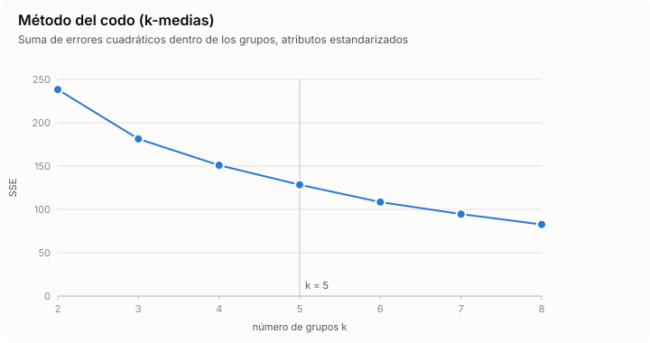
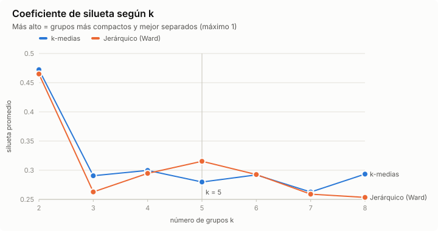
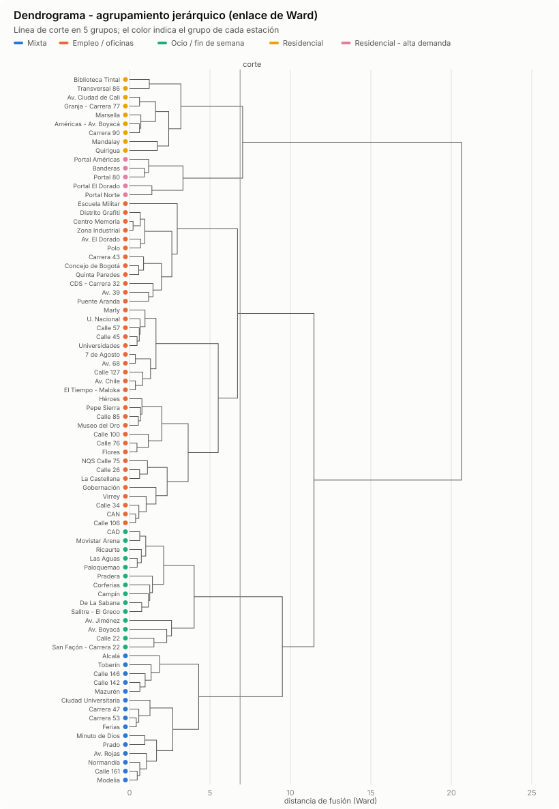

# Resultados - Actividad 4: agrupamiento de estaciones de TransMilenio

Generado el 2026-10-09 con `python -m actividad4 agrupar -k 5`.

## Datos y atributos

Fuente: entradas y salidas cada 15 minutos publicadas por TRANSMILENIO S.A., sumadas por hora (`datos/afluencia_transmilenio_real.csv`).

80 estaciones. Cada una se describe con 6 atributos calculados a partir de sus entradas y salidas, y luego estandarizados (puntuación z):

| Atributo | Descripción | Media | Desv. |
|---|---|---|---|
| `log_volumen` | log10 de las entradas de un día hábil promedio | 3.949 | 0.350 |
| `pico_am_entradas` | fracción de las entradas del día hábil entre 5:00 y 8:59 | 0.221 | 0.174 |
| `pico_pm_entradas` | fracción de las entradas del día hábil entre 16:00 y 19:59 | 0.390 | 0.143 |
| `pico_am_salidas` | fracción de las salidas del día hábil entre 6:00 y 9:59 | 0.407 | 0.146 |
| `pico_pm_salidas` | fracción de las salidas del día hábil entre 17:00 y 20:59 | 0.214 | 0.122 |
| `ratio_fin_de_semana` | entradas de un día de fin de semana o festivo / entradas de un día hábil | 0.381 | 0.107 |

## Elección del número de grupos





| k | SSE (k-medias) | Silueta k-medias | Silueta Ward |
|---|---|---|---|
| 2 | 238.3 | 0.472 | 0.465 |
| 3 | 181.3 | 0.291 | 0.263 |
| 4 | 151.0 | 0.300 | 0.295 |
| 5 | 128.5 | 0.280 | 0.315 |
| 6 | 108.5 | 0.292 | 0.293 |
| 7 | 94.6 | 0.263 | 0.259 |
| 8 | 82.6 | 0.293 | 0.253 |

La silueta de k-medias es máxima en k = 2. **Se usa k = 5 (fijado por el usuario).**

## Grupos encontrados (k-medias)

| Grupo | Estaciones | Entradas/día | `pico_am_entradas` | `pico_pm_entradas` | `pico_am_salidas` | `pico_pm_salidas` | `ratio_fin_de_semana` |
|---|---|---|---|---|---|---|---|
| 1. Empleo / oficinas 1 | 28 | 5.807 | 0.19 | 0.41 | 0.44 | 0.19 | 0.35 |
| 2. Empleo / oficinas 2 | 19 | 11.583 | 0.08 | 0.53 | 0.57 | 0.11 | 0.27 |
| 3. Ocio / fin de semana | 14 | 8.785 | 0.11 | 0.45 | 0.42 | 0.15 | 0.53 |
| 4. Residencial | 13 | 7.293 | 0.47 | 0.18 | 0.22 | 0.39 | 0.40 |
| 5. Residencial - alta demanda | 6 | 44.437 | 0.52 | 0.15 | 0.14 | 0.44 | 0.48 |

- **Empleo / oficinas 1** (28): 7 de Agosto, Alcalá, Av. 68, Av. El Dorado, Av. Rojas, CDS - Carrera 32, Calle 161, Calle 45, Calle 57, Carrera 43, Carrera 47, Carrera 53, Centro Memoria, Ciudad Universitaria, Concejo de Bogotá, Distrito Grafiti, Escuela Militar, Ferias, Marly, Modelia, Normandía, Polo, Prado, Puente Aranda, Quinta Paredes, U. Nacional, Universidades, Zona Industrial.
- **Empleo / oficinas 2** (19): Av. 39, Av. Chile, CAN, Calle 100, Calle 106, Calle 127, Calle 26, Calle 34, Calle 76, Calle 85, El Tiempo - Maloka, Flores, Gobernación, Héroes, La Castellana, Museo del Oro, NQS Calle 75, Pepe Sierra, Virrey.
- **Ocio / fin de semana** (14): Av. Boyacá, Av. Jiménez, CAD, Calle 22, Campín, Corferias, De La Sabana, Las Aguas, Movistar Arena, Paloquemao, Pradera, Ricaurte, Salitre - El Greco, San Façón - Carrera 22.
- **Residencial** (13): Américas - Av. Boyacá, Av. Ciudad de Cali, Calle 142, Calle 146, Carrera 90, Granja - Carrera 77, Mandalay, Marsella, Mazurén, Minuto de Dios, Quirigua, Toberín, Transversal 86.
- **Residencial - alta demanda** (6): Banderas, Biblioteca Tintal, Portal 80, Portal Américas, Portal El Dorado, Portal Norte.


## Comparación con el agrupamiento jerárquico (Ward)



| Medida | k-medias | Jerárquico (Ward) |
|---|---|---|
| Silueta promedio | 0.280 | 0.315 |
| Índice de Rand ajustado vs. vocación supuesta en la muestra | 0.070 | 0.098 |

Concordancia entre los dos métodos (índice de Rand ajustado): **0.488**. Estaciones asignadas distinto: 7 de Agosto, Av. 68, Av. El Dorado, Biblioteca Tintal, CDS - Carrera 32, Calle 142, Calle 146, Calle 45, Calle 57, Carrera 43, Centro Memoria, Concejo de Bogotá, Distrito Grafiti, Escuela Militar, Marly, Mazurén, Minuto de Dios, Polo, Puente Aranda, Quinta Paredes, Toberín, U. Nacional, Universidades, Zona Industrial.

## ¿Se cumplen los supuestos de la muestra?

La muestra sintética se generó suponiendo una vocación para cada estación: empleo o educativa / ocio según una lista de atractores (Calle 72, Calle 100, CAN, U. Nacional, Campín, Corferias, ...), residencial si es portal o está a más de 7,5 km del centro, y mixta en otro caso. Esa vocación no se usó para agrupar. La tabla la compara con los grupos encontrados en los datos reales:

| Grupo \ vocación | residencial | empleo | educativa_ocio | mixta |
|---|---|---|---|---|
| Empleo / oficinas 1 | 12 | 3 | 5 | 8 |
| Empleo / oficinas 2 | 4 | 10 | 0 | 5 |
| Ocio / fin de semana | 1 | 5 | 4 | 4 |
| Residencial | 10 | 0 | 0 | 3 |
| Residencial - alta demanda | 6 | 0 | 0 | 0 |

## De vuelta a la base de conocimiento

Los grupos se exportan como hechos lógicos en [perfiles.kb](perfiles.kb) (`perfil_estacion(Estacion, Perfil).`) y se consultan junto con las reglas de la Actividad 2. Por ejemplo, el perfil de las estaciones de integración que infiere la base de conocimiento:

```text
perfil_estacion(E, P), estacion_de_integracion(E)
  Av. Jiménez: ocio_fin_de_semana
  Calle 100: empleo_2
  Escuela Militar: empleo_1
  Héroes: empleo_2
  Las Aguas: ocio_fin_de_semana
  Ricaurte: ocio_fin_de_semana
  Universidades: empleo_1
```

La asignación completa de cada estación está en [asignacion.csv](asignacion.csv).
