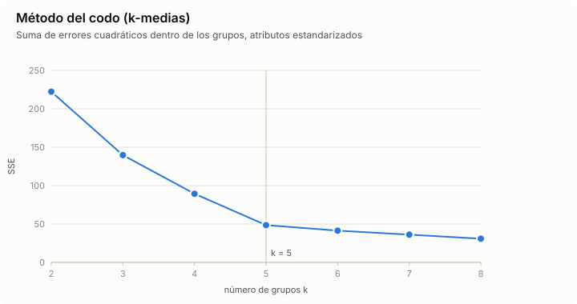
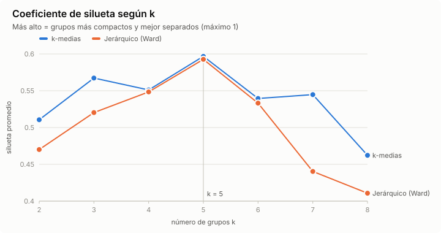
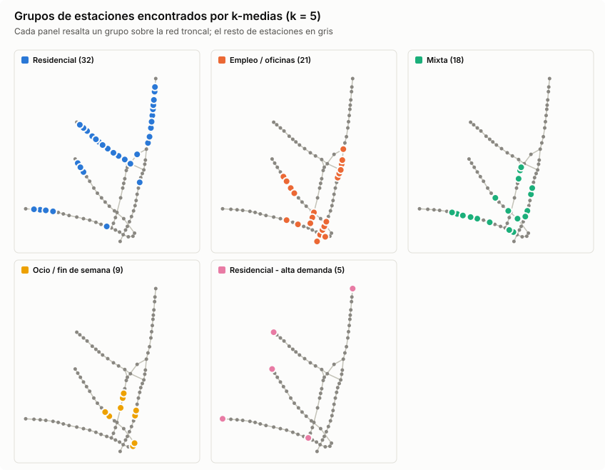
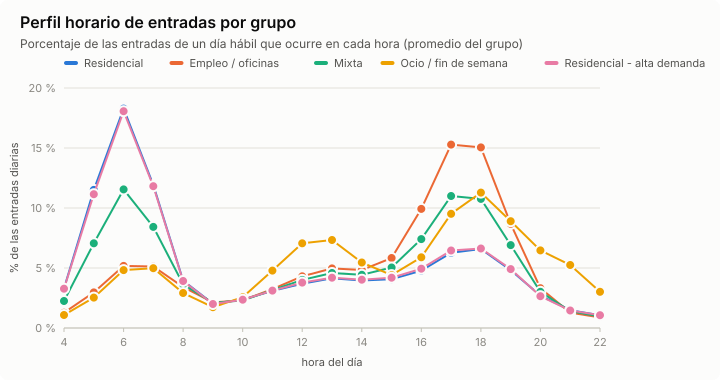
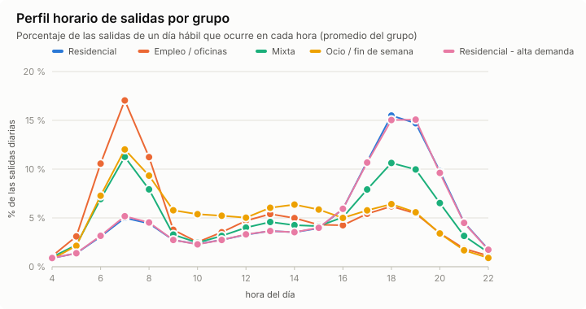
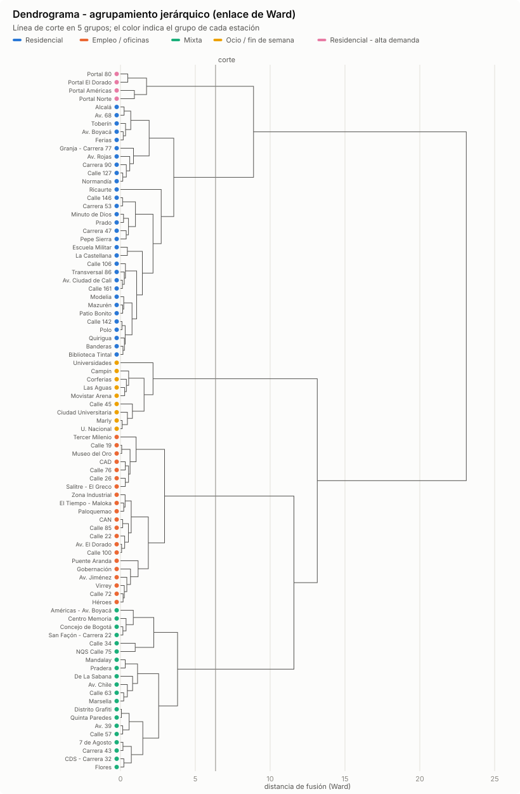

# Resultados - Actividad 4: agrupamiento de estaciones de TransMilenio

Generado el 2026-10-09 con `python -m actividad4 agrupar --datos muestra`.

## Datos y atributos

Fuente: muestra sintética generada con semilla fija (`datos/afluencia_transmilenio_muestra.csv`).

85 estaciones. Cada una se describe con 6 atributos calculados a partir de sus entradas y salidas, y luego estandarizados (puntuación z):

| Atributo | Descripción | Media | Desv. |
|---|---|---|---|
| `log_volumen` | log10 de las entradas de un día hábil promedio | 3.969 | 0.190 |
| `pico_am_entradas` | fracción de las entradas del día hábil entre 5:00 y 8:59 | 0.321 | 0.133 |
| `pico_pm_entradas` | fracción de las entradas del día hábil entre 16:00 y 19:59 | 0.333 | 0.110 |
| `pico_am_salidas` | fracción de las salidas del día hábil entre 6:00 y 9:59 | 0.271 | 0.117 |
| `pico_pm_salidas` | fracción de las salidas del día hábil entre 17:00 y 20:59 | 0.368 | 0.137 |
| `ratio_fin_de_semana` | entradas de un día de fin de semana o festivo / entradas de un día hábil | 0.450 | 0.081 |

## Elección del número de grupos





| k | SSE (k-medias) | Silueta k-medias | Silueta Ward |
|---|---|---|---|
| 2 | 222.3 | 0.511 | 0.470 |
| 3 | 139.7 | 0.567 | 0.520 |
| 4 | 89.4 | 0.551 | 0.548 |
| 5 | 48.6 | 0.597 | 0.593 |
| 6 | 41.4 | 0.540 | 0.533 |
| 7 | 36.2 | 0.545 | 0.440 |
| 8 | 30.9 | 0.462 | 0.411 |

La silueta de k-medias es máxima en k = 5. **Se usa k = 5.**

## Grupos encontrados (k-medias)

| Grupo | Estaciones | Entradas/día | `pico_am_entradas` | `pico_pm_entradas` | `pico_am_salidas` | `pico_pm_salidas` | `ratio_fin_de_semana` |
|---|---|---|---|---|---|---|---|
| 1. Residencial | 32 | 8.645 | 0.46 | 0.22 | 0.15 | 0.51 | 0.42 |
| 2. Empleo / oficinas | 21 | 10.571 | 0.17 | 0.49 | 0.43 | 0.21 | 0.42 |
| 3. Mixta | 18 | 6.455 | 0.31 | 0.36 | 0.29 | 0.35 | 0.42 |
| 4. Ocio / fin de semana | 9 | 9.288 | 0.15 | 0.36 | 0.34 | 0.21 | 0.69 |
| 5. Residencial - alta demanda | 5 | 33.098 | 0.45 | 0.23 | 0.16 | 0.50 | 0.42 |

- **Residencial** (32): Alcalá, Av. 68, Av. Boyacá, Av. Ciudad de Cali, Av. Rojas, Banderas, Biblioteca Tintal, CDS - Carrera 32, Calle 106, Calle 127, Calle 142, Calle 146, Calle 161, Carrera 47, Carrera 53, Carrera 90, Escuela Militar, Ferias, Flores, Granja - Carrera 77, La Castellana, Mazurén, Minuto de Dios, Modelia, Normandía, Patio Bonito, Pepe Sierra, Polo, Prado, Quirigua, Toberín, Transversal 86.
- **Empleo / oficinas** (21): Av. El Dorado, Av. Jiménez, CAD, CAN, Calle 100, Calle 19, Calle 22, Calle 26, Calle 72, Calle 76, Calle 85, El Tiempo - Maloka, Gobernación, Héroes, Museo del Oro, Paloquemao, Puente Aranda, Salitre - El Greco, Tercer Milenio, Virrey, Zona Industrial.
- **Mixta** (18): 7 de Agosto, Américas - Av. Boyacá, Av. 39, Av. Chile, Calle 34, Calle 57, Calle 63, Carrera 43, Centro Memoria, Concejo de Bogotá, De La Sabana, Distrito Grafiti, Mandalay, Marsella, NQS Calle 75, Pradera, Quinta Paredes, San Façón - Carrera 22.
- **Ocio / fin de semana** (9): Calle 45, Campín, Ciudad Universitaria, Corferias, Las Aguas, Marly, Movistar Arena, U. Nacional, Universidades.
- **Residencial - alta demanda** (5): Portal 80, Portal Américas, Portal El Dorado, Portal Norte, Ricaurte.







## Comparación con el agrupamiento jerárquico (Ward)



| Medida | k-medias | Jerárquico (Ward) |
|---|---|---|
| Silueta promedio | 0.597 | 0.593 |
| Índice de Rand ajustado vs. vocación oculta | 0.829 | 0.879 |

Concordancia entre los dos métodos (índice de Rand ajustado): **0.904**. Estaciones asignadas distinto: CDS - Carrera 32, Flores, Ricaurte.

## Validación externa

Como los datos son una muestra sintética, se conoce la vocación con la que se generó cada estación (no se usó para agrupar). La tabla compara los grupos con esa vocación oculta:

| Grupo \ vocación | residencial | empleo | educativa_ocio | mixta |
|---|---|---|---|---|
| Residencial | 30 | 0 | 0 | 2 |
| Empleo / oficinas | 0 | 21 | 0 | 0 |
| Mixta | 0 | 0 | 0 | 18 |
| Ocio / fin de semana | 0 | 0 | 9 | 0 |
| Residencial - alta demanda | 4 | 0 | 0 | 1 |

## De vuelta a la base de conocimiento

Los grupos se exportan como hechos lógicos en [perfiles.kb](perfiles.kb) (`perfil_estacion(Estacion, Perfil).`) y se consultan junto con las reglas de la Actividad 2. Por ejemplo, el perfil de las estaciones de integración que infiere la base de conocimiento:

```text
perfil_estacion(E, P), estacion_de_integracion(E)
  Av. Jiménez: empleo
  Calle 100: empleo
  Escuela Militar: residencial
  Héroes: empleo
  Las Aguas: ocio_fin_de_semana
  Ricaurte: residencial_alta_demanda
  Universidades: ocio_fin_de_semana
```

La asignación completa de cada estación está en [asignacion.csv](asignacion.csv).
